# Navaja Chilena 🇨🇱

**La navaja suiza de Home Assistant para Chile.** Indicadores económicos, Metro, paraderos, sismos, cartelera de cine,
feriados, efemérides y mucho más, en una sola integración que se instala en un minuto y no necesita claves de API.

[](https://my.home-assistant.io/redirect/hacs_repository/?owner=Ctuna89&repository=navaja-chilena-HA&category=integration)

[](https://hacs.xyz)
[](https://github.com/Ctuna89/navaja-chilena-HA/releases)
[](LICENSE)

## Todo lo que necesitas de Chile en tu Home Assistant

| | |
|---|---|
| 💰 **Indicadores económicos** | UF, dólar, euro, UTM, IPC, IVP, Imacec, TPM, cobre, desempleo, yen y más |
| 📈 **Bolsa de Santiago** | Último cierre del IPSA con su variación diaria en puntos y en % |
| 🪙 **Criptomonedas** | Bitcoin y Ethereum en pesos chilenos, con variación de 24 horas y 7 días |
| 🚇 **Metro de Santiago** | Estado de cada línea y de sus estaciones, y aviso de **red cerrada** fuera de horario |
| 🚌 **Paraderos** | Minutos para el próximo bus en cada paradero de Red Movilidad, por recorrido |
| 🌋 **Sismos** | Último sismo del Centro Sismológico Nacional y otro con coordenadas para verlo en un mapa |
| 📅 **Feriados** | Próximo feriado, cuántos días faltan y si es irrenunciable |
| 🌫️ **Calidad del aire y UV** | PM2.5, PM10, índice de calidad del aire e índice UV donde vives |
| 💊 **Farmacias de turno** | Las farmacias de turno de tu comuna, con dirección, horario y teléfono |
| 🎬 **Cartelera de cine** | La cartelera de hoy de tu cine Cinemark favorito, o **el más cercano a tu casa** |
| 🇨🇱 **Efemérides** | Los días significativos y las efemérides chilenas de hoy, y el próximo día significativo |
| ⚽ **Fútbol** | Próximos partidos, resultados y posición de tu equipo de la Primera División, la tabla y las fechas de la liga, y los partidos de La Roja |
| 📰 **Noticias por tema** | Titulares de La Tercera y Cooperativa separados por tema (nacional, política, mundo, economía, deportes, tecnología…), con enlace a cada nota |
| ⛽ **Combustibles** | Dónde está la bencina (93, 95, 97) o el diésel más barato cerca de tu casa, con precio, marca, dirección y distancia |
| 💳 **Descuentos de tus tarjetas** | Eliges tus tarjetas (Banco de Chile, BCI, Santander, CMR…) y las categorías que te interesan (combustibles, comida, salud…) y ves los descuentos que aplican **hoy** |
| 🚗 **Restricción vehicular y revisión técnica** | Con el último dígito de tu patente: si hoy tienes restricción, tu próximo día con restricción y el mes de tu revisión técnica |
| ✝️ **Santoral** | El santo del día (y el de mañana), sin necesidad de internet |

## Por qué Navaja Chilena

- **Sin claves de API ni cuentas.** Instalas y funciona.
- **Tú eliges qué usar.** Cada módulo se activa o desactiva desde la interfaz, y puedes cambiarlo cuando quieras.
- **Resistente.** Cada módulo es independiente: si una fuente no responde, solo sus sensores quedan «no disponibles» y el
  resto sigue funcionando. Nunca se muestra un dato inventado: si el Metro no responde, no verás «operativa» por defecto.
- **Pensada para Chile.** Horario real del Metro, hora de Santiago, formatos y textos en español (también disponible en inglés).
- **Tarjetas listas para copiar.** Más abajo hay [22 ejemplos](#tarjetas-de-ejemplo) para pegar en tu panel.

## Instalación

### Con HACS (recomendado)

1. Pulsa el botón **Añadir a HACS** de arriba, o en HACS → ⋮ → *Repositorios personalizados* pega
   `https://github.com/Ctuna89/navaja-chilena-HA` y elige la categoría **Integración**.
2. Instala **Navaja Chilena** y reinicia Home Assistant.
3. Ve a *Ajustes → Dispositivos y servicios → Añadir integración* y busca **Navaja Chilena**.

### Configuración

El asistente te pregunta qué quieres activar:

- los **indicadores** que te interesan (UF, dólar, euro…),
- el **Metro**, los **sismos**, los **feriados**, el **IPSA**, el **santoral**, las **efemérides**, la **calidad del aire** y las **criptomonedas** (un interruptor cada uno),
- tus **paraderos** (códigos separados por coma, por ejemplo `PC615, PA433`; se comprueba que existan),
- tu **comuna** para las farmacias de turno,
- tu **equipo** de la Primera División (o toda la liga) y **La Roja**, para ver partidos, resultados y tabla,
- los **combustibles** que usas (93, 95, 97 o diésel), el **radio** de búsqueda alrededor de tu casa y la **antigüedad máxima** de los precios,
- los **temas de noticias** que quieres seguir y cuántos titulares por tema,
- la **ciudad y los paraderos** de la Red Regional (si vives fuera de Santiago),
- tus **tarjetas** (descuentos en bencina de hoy) y las **categorías** de descuentos que te interesan (combustibles, comida, salud y belleza, etc.),
- el **último dígito de tu patente** y el tipo de vehículo, para la restricción vehicular y la revisión técnica,
- tu **cine** Cinemark: uno de los 22 cines del país, o *«El más cercano a mi casa»* según la ubicación de tu Home Assistant.

Todo se puede cambiar después en *Configurar*, sin reinstalar.

## Detalle de cada módulo

Los ids de las entidades llevan como prefijo el nombre del dispositivo (por ejemplo `sensor.indicadores_economicos_uf`).

### 💰 Indicadores económicos
`sensor.indicadores_economicos_<indicador>` · actualización cada hora · atributo `fecha` con el día del valor.
Disponibles: UF, dólar observado, euro, UTM, IPC, IVP, Imacec, TPM, libra de cobre, tasa de desempleo, bitcoin (USD), yen y dólar acuerdo.

### 📈 Bolsa de Santiago
`sensor.bolsa_de_santiago_ipsa` · último cierre del IPSA en puntos · atributos `variacion_puntos`, `variacion_pct`,
`fecha_cierre`, `cierre_anterior` y `fecha_cierre_anterior`. Es un dato de cierre diario: no cambia los fines de semana ni los feriados.

### 🪙 Criptomonedas
`sensor.criptomonedas_buda_bitcoin` y `sensor.criptomonedas_buda_ethereum` · precio en CLP · atributos `variacion_24h_pct`,
`variacion_7d_pct` y `volumen_24h` · actualización cada 5 minutos.

### 🚇 Metro de Santiago
`sensor.metro_de_santiago_linea_1` … `_linea_6` y `_linea_4a` · estado `operativa`, `con_problemas` o `cerrada` ·
actualización cada 2 minutos.

- Los estados se muestran como «Operativa», «Con problemas» y «Cerrada» (en la interfaz en español).
- Atributos: `mensaje`, `estaciones` (estado de cada una), `estaciones_con_problemas`, `horario_apertura` y `horario_cierre`.
- **Horario de servicio** (hora de Santiago): lunes a viernes 06:00–23:00, sábado 06:30–23:00, domingo y festivos 07:30–23:00.
  Fuera de ese horario todas las líneas y estaciones figuran como `cerrada`.  Los festivos se consideran automáticamente.
- Si la fuente no responde, el sensor queda «no disponible».

### 🚌 Paraderos
`sensor.paraderos_red_movilidad_paradero_<código>` · minutos para el próximo bus · actualización cada minuto.
Atributos: `nombre`, `estado`, `recorridos` (cada recorrido con sus minutos y buses en camino) y `recorridos_sin_buses`.

### 🚍 Paraderos de la Red Regional (ciudades fuera de Santiago)
`sensor.paraderos_red_regional_<ciudad>_paradero_<código>` y `binary_sensor.paraderos_red_regional_<ciudad>_alertas_del_servicio` · minutos hasta la próxima
llegada a tus paraderos en las ciudades de la Red Regional (Arica, Iquique, Antofagasta, Copiapó, La Serena–Coquimbo, Gran Valparaíso, Rancagua, Talca, Chillán, Gran
Concepción, Temuco, Valdivia, Osorno, Puerto Montt, Punta Arenas y más) · actualización cada minuto.

- Eliges **la ciudad** y escribes los **códigos de paradero** (el que aparece en el letrero o en la app Red Regional, por ejemplo `75` o `P60094`); se comprueba que existan en esa ciudad.
- Atributos del sensor: `nombre` del paradero, `ciudad`, `proximas` (hasta 8 llegadas con servicio, sentido, hora estimada, minutos, la estimación del servicio —«Llegando», «11 a 15 min», «+ de 25 min»—,
  si es **en tiempo real** y la distancia del bus) y `alertas`.
- El sensor binario se enciende cuando el servicio informa alertas que afectan al paradero (por ejemplo, «el servicio 302 no está enviando información en tiempo real»).
- Si el servicio no responde, solo esos sensores quedan sin datos; el resto de la integración sigue funcionando.
- Los datos vienen de **TransApp / DTPR**, el sistema detrás de la app Red Regional. Es un servicio **no oficial y sin documentación pública**: puede cambiar sin aviso. Este módulo no está afiliado al Ministerio de Transportes ni a los operadores.

### 🌋 Sismos
- `sensor.sismos_chile_ultimo_sismo_csn`: magnitud del último sismo del Centro Sismológico Nacional, con `referencia`
  (ubicación en español), `profundidad_km` y `fecha`.
- `sensor.sismos_chile_ultimo_sismo_con_coordenadas_usgs`: el último sismo en Chile con `latitude` y `longitude`, ideal para la tarjeta de mapa.

Actualización cada 5 minutos.

### 📅 Feriados
`sensor.feriados_chile_proximo_feriado` (fecha, con `nombre`, `tipo` e `irrenunciable`) y
`sensor.feriados_chile_dias_para_el_proximo_feriado`.

### 🌫️ Calidad del aire y UV
`sensor.calidad_del_aire_y_uv_pm2_5`, `..._pm10`, `..._indice_de_calidad_del_aire_us_aqi` y `..._indice_uv`, calculados para la
ubicación configurada en tu Home Assistant · actualización cada 30 minutos.

### 💊 Farmacias de turno
`sensor.farmacias_de_turno_<comuna>` · cantidad de farmacias de turno hoy · atributo `farmacias` (hasta 20, con nombre,
dirección, horario, teléfono y coordenadas) · datos del servicio Farmanet del Ministerio de Salud.

### 🎬 Cartelera de cine
`sensor.<nombre del cine>_cartelera_de_hoy` · cantidad de películas en cartelera hoy · actualización cada 3 horas.
Atributos: `peliculas` (título, duración, género, `poster` y las funciones con hora, formato y sala), `resumen` (texto listo para
una tarjeta), `proxima_funcion` (con su `poster`) y `fecha`. La imagen de la entidad es el póster de la próxima función. Las funciones de trasnoche (antes de las 05:00) cuentan para el día anterior.
Cines disponibles: los 22 de **Cinemark** en Chile.

### 🇨🇱 Efemérides
- `sensor.efemerides_chilenas_efemerides_de_hoy`: la efeméride principal de hoy. Primero aparecen los días significativos de
  Chile (hechos históricos y días conmemorativos, con su descripción) y después, como complemento, los sucesos, fallecimientos y
  nacimientos chilenos de «Un día como hoy». Atributos: `efemerides` (hasta 10, cada una con su `fuente` y `enlace`), `total`,
  `resumen` y `fuentes`.
- `sensor.efemerides_chilenas_proximo_dia_significativo`: título, `fecha`, `dias_restantes` y `descripcion`. La lista de días
  significativos corresponde al mes en curso, así que tras el último del mes el sensor se muestra «no disponible» hasta que cambia el mes.

### ⚽ Fútbol
Elige tu equipo de la Primera División, la liga completa, La Roja, o cualquier combinación. Los datos llegan en español, con los logos de
cada equipo, y se consultan **cada 3 horas**; mientras hay un partido en juego se actualizan **cada 5 minutos** (cada 15 minutos
cuando falta menos de 3 horas para que empiece).

| Entidad | Qué muestra |
|---|---|
| `sensor.futbol_<equipo>_proximo_partido` | Fecha y hora del próximo partido; atributos `rival`, `condicion` (local o visita), `competencia`, `hora_local`, `dias_restantes`, `estadio`, `en_vivo`, `marcador`, `minuto` y `siguientes` (los 3 partidos que vienen después) |
| `sensor.futbol_<equipo>_ultimo_resultado` | «Ganó 2-1 vs Ñublense»; atributos `marcador`, `local`, `visita`, `fecha`, `forma` (últimos 5: `GEPPG`) y `ultimos` |
| `sensor.futbol_<equipo>_posicion_en_la_tabla` | Posición; atributos `puntos`, `jugados`, `ganados`, `empatados`, `perdidos`, `goles_a_favor`, `goles_en_contra`, `diferencia_de_goles`, `lider`, `puntos_bajo_el_lider` |
| `sensor.futbol_primera_division_tabla_de_posiciones` | El líder; atributo `tabla` con los 16 equipos (posición, PJ, PG, PE, PP, GF, GC, DG, Pts) |
| `sensor.futbol_primera_division_proxima_fecha` | Cuándo parte la próxima fecha; atributo `partidos` con local, visita, hora, estadio y estado |
| `sensor.futbol_primera_division_ultima_fecha` | Cantidad de partidos; atributo `resultados` con los marcadores de la última fecha |
| `sensor.futbol_la_roja_proximo_partido` y `..._ultimo_resultado` | Lo mismo que para un equipo, para la selección en todas sus competencias (amistosos, Eliminatorias y Copa América). Si no hay partido programado, el próximo partido aparece «sin valor» |

La lista de equipos corresponde a la Primera División 2026 y se actualiza cuando cambian los equipos de la liga.

### ⛽ Combustibles
`sensor.combustibles_gasolina_93_mas_barata`, `..._95_...`, `..._97_...` y `sensor.combustibles_diesel_mas_barato` · precio más bajo en CLP por
litro entre las estaciones de servicio dentro del radio elegido (2, 5, 10 o 20 km) alrededor de la ubicación de tu Home Assistant ·
actualización cada 3 horas.

- Atributos: `marca`, `direccion`, `comuna`, `distancia_km`, `actualizado` y `antiguedad_dias` (cuándo informó el precio la estación), `atencion`
  (autoservicio o asistido), `promedio_en_radio`, `estaciones_en_radio`, `mas_baratas` (las 5 más baratas) y `latitude`/`longitude`
  de la estación. La imagen de la entidad es el logo de la marca.
- Los precios los informan las propias estaciones a la Comisión Nacional de Energía cuando los cambian, y muchas tardan en hacerlo: un
  precio viejo suele ser **más bajo que el actual** y daría un «más barato» engañoso. Por eso solo se consideran los precios informados
  en los últimos **14 días** (puedes elegir 7, 14 o 30). Con un tope más estricto hay menos estaciones; si ninguna cumple, el sensor
  queda sin valor. También se ignoran los valores imposibles. Si una estación tiene precio de autoservicio se usa ese; si solo tiene
  atención asistida, se usa el asistido.
- Si ninguna estación del radio tiene un precio vigente, el sensor queda sin valor y el atributo `motivo` lo explica.

### 💳 Descuentos de tus tarjetas
Un sensor por cada categoría que elijas: `sensor.descuentos_de_tarjetas_descuentos_de_hoy_combustibles`, `..._comida`, `..._salud_y_belleza`, etc. ·
el valor es la cantidad de descuentos de **hoy** para tus tarjetas.

- Eliges **tus tarjetas** (16: Banco de Chile, BancoEstado, BCI, BICE, Cencosud, CMR Falabella, Copec, Itaú, Lider, MACH, Mercado Pago,
  Ripley, Santander, Scotiabank, Security y Tenpo) y **las categorías** que te interesan (combustibles, comida, tiendas y supermercados,
  salud y belleza, entretención, viajes, etc.). Lo que no eliges no se consulta ni se muestra.
- Atributos: `hoy` (comercio, tarjeta, descuento, detalle, enlace e imagen; hasta 15), `sin_dia_indicado` (beneficios que no precisan un
  día, para que los revises), `total_en_categoria`, `aviso` y `fuente`.
- **Actualización semanal y el día 1 de cada mes**, caiga el día que caiga. Lo descargado se guarda y se reutiliza al reiniciar Home
  Assistant, así que el sitio se consulta poco. Cada día a medianoche el sensor recalcula qué aplica según el día de la semana.
- Los días se leen del texto de cada beneficio («todos los miércoles», «lunes a viernes», «excepto los martes», «fines de semana»),
  se respetan los beneficios limitados a ciertos meses y se descartan los que ya vencieron según su vigencia («válida hasta el 31 de
  diciembre de 2026»). Si el texto no indica días, el beneficio aparece en `sin_dia_indicado`; nunca
  se da por vigente algo que no se pudo confirmar.
- Para que te avisen: crea una automatización con el disparador *«Estado numérico»* del sensor (por encima de 0) y una notificación
  con el contenido de `hoy` (ejemplo más abajo).
- Si el sitio no responde, se siguen mostrando los últimos datos descargados; si nunca se pudo descargar, el sensor queda sin valor.
- Las condiciones, fechas y topes de cada descuento las define el emisor: revisa siempre el detalle antes de comprar.

### ⛽ Descuentos en bencina de tus tarjetas
`sensor.combustibles_descuentos_en_bencina_hoy` · cuántos descuentos en bencina tienes **hoy** con las tarjetas que marcaste (no requiere elegir categorías).

- Atributos: `hoy` (estaciones, tarjeta, descuento, detalle, `confirmado` y `fuente`), `mejor_ahorro_clp_litro`, `proximo_dia` y `proximo` (el próximo
  día con descuento y cuáles son), `calendario` (mes del calendario) y `actualizado`.
- Se alimenta de un **calendario mensual** del repositorio ([`data/bencina.json`](data/bencina.json)), porque los descuentos de bencina se
  publican en las páginas de cada estación y banco, no en un servicio con datos estructurados. Se renueva **solo, una vez al mes** (se investiga, se valida y se publica de forma automática) y cada fila indica su
  fuente (Copec, Shell, Aramco, bancos y prensa). Las condiciones que cambian la decisión (tope de litros, activaciones, crédito o débito) van en `detalle`;
  lo que no se pudo confirmar con una fuente oficial del mes aparece con `confirmado: false`.
- Si el calendario no es del mes en curso, el sensor queda sin valor y el atributo `motivo` lo explica: nunca se muestran descuentos de un mes anterior como vigentes.
- ¿Faltan descuentos o hay un error? Puedes proponer el cambio en `data/bencina.json` con un pull request (el método y la validación están en [`data/README.md`](data/README.md)).

### 📰 Noticias por tema
`sensor.noticias_titulares_<tema>` · un sensor por cada tema que elijas: **Nacional, Política, Mundo, Economía, Deportes, Tecnología, Sociedad, Cultura y tendencias y Servicios**.
El valor es el titular más reciente del tema; los atributos traen la lista completa.

- Los titulares vienen de **La Tercera** y de **Cooperativa.cl**, que publican sus noticias en feeds RSS públicos. Cada tema reúne lo de ambos medios, ordenado por hora, sin repetidos.
  Política y Servicios salen de La Tercera; Economía y Sociedad, de Cooperativa; el resto combina los dos.
- Atributos: `titulares` (hasta 5, 10 o 15 según elijas, con `titulo`, `medio`, `enlace`, `hora` y un `resumen` corto), y `medio` y `enlace` del titular más reciente.
- Solo se muestran el titular, la bajada corta y el enlace a la nota original en el sitio del medio; el contenido es de sus autores.
- Actualización cada 30 minutos (Cooperativa, como máximo cada hora, que es la vigencia que declara). Si uno de los medios no responde, el tema sigue con el otro; si ninguno, queda sin datos.

### 🚗 Mi vehículo: restricción vehicular y revisión técnica
Eliges el **último dígito** de tu patente y el **tipo de vehículo**. No usa internet: las reglas están incluidas en la integración y se
actualizan con ella cuando el Ministerio publica una nueva resolución.

| Entidad | Qué muestra |
|---|---|
| `binary_sensor.mi_vehiculo_restriccion_vehicular_hoy` | «Con restricción» o «Sin restricción»; atributos `motivo`, `digitos_hoy`, `rige_ahora`, `horario` |
| `sensor.mi_vehiculo_digitos_con_restriccion_hoy` | Los dígitos restringidos hoy para tu tipo de vehículo (por ejemplo `8-9`, `Todos` o `Ninguno`) |
| `sensor.mi_vehiculo_proxima_restriccion` | Fecha de tu próximo día con restricción, con `dias_restantes` |
| `sensor.mi_vehiculo_mes_de_revision_tecnica` | Mes de preferencia de tu revisión técnica, con `meses_restantes` |
| `binary_sensor.mi_vehiculo_revision_tecnica_este_mes` | «Este mes» si te toca ahora |

**Restricción vehicular (Región Metropolitana, temporada 2026).** Del 1 de mayo al 31 de agosto, de lunes a viernes salvo festivos, entre las
07:30 y las 21:00, en la provincia de Santiago y las comunas de Puente Alto y San Bernardo. Dígitos restringidos según la
[Resolución Exenta N° 1698/2026](https://mtt.gob.cl/restriccion-vehicular-2026/) del Ministerio de Transportes:

| Día | Con sello verde (inscrito antes de sept. 2011) y motos (antes de sept. 2010) | Sin sello verde, fuera del anillo Américo Vespucio |
|---|---|---|
| Lunes | 8 y 9 | 6, 7, 8 y 9 |
| Martes | 0 y 1 | 0, 1, 2 y 3 |
| Miércoles | 2 y 3 | 4, 5, 6 y 7 |
| Jueves | 4 y 5 | 8, 9, 0 y 1 |
| Viernes | 6 y 7 | 2, 3, 4 y 5 |

Los autos sin sello verde que circulan **dentro del anillo Américo Vespucio** tienen restricción con **todos** los dígitos, y los autos con sello
verde inscritos desde septiembre de 2011 no tienen restricción.

> **Importante.** En preemergencia o emergencia ambiental el Ministerio decreta **dígitos adicionales** y los informa por sus canales
> oficiales; la integración **no los incluye**, así que en esos días revisa también la información oficial. Cada año el Ministerio publica
> una nueva resolución (en abril): hasta que se cargue, el sensor aparece «no disponible» (de enero a marzo no hay restricción).

**Revisión técnica.** El mes depende del último dígito de la patente, según la
[ficha de ChileAtiende](https://www.chileatiende.gob.cl/fichas/23978) (Subsecretaría de Transportes):

| Dígito | 9 | 0 | 1 | 2 | 3 | 4 | 5 | 6 | 7 | 8 |
|---|---|---|---|---|---|---|---|---|---|---|
| Mes | Enero | Febrero | Abril | Mayo | Junio | Julio | Agosto | Septiembre | Octubre | Noviembre |

Marzo y diciembre no tienen dígito. Es el mes de **preferencia** en las plantas, no una fecha límite: tu plazo real depende de la vigencia de tu
certificado anterior. Aplica a los vehículos con revisión anual; taxis, buses, vehículos de carga y otros con revisión semestral tienen plazos distintos.

Ejemplo de automatización: aviso a las 7:00 los días con restricción.

```yaml
triggers:
  - trigger: time
    at: "07:00:00"
conditions:
  - condition: state
    entity_id: binary_sensor.mi_vehiculo_restriccion_vehicular_hoy
    state: "on"
actions:
  - action: notify.notify
    data:
      message: >-
        Hoy tu auto tiene restricción vehicular (dígitos
        {{ state_attr('binary_sensor.mi_vehiculo_restriccion_vehicular_hoy', 'digitos_hoy') }}).
```

### ✝️ Santoral
`sensor.santoral_santo_del_dia` · atributos `fecha` y `mañana`. Usa el santoral católico tradicional; está incluido en la
integración (`santoral.py`), funciona sin internet y puedes editarlo si tu calendario difiere en algún día.

## Tarjetas de ejemplo

Listas para copiar y pegar: usan solo tarjetas que ya trae Home Assistant, sin instalar nada extra. Las imágenes son
capturas reales de Home Assistant (los valores cambian con el tiempo). En tu panel pulsa
*⋮ → Editar panel → Añadir tarjeta → Manual* y pega el YAML. Reemplaza el cine, la comuna y los paraderos de los ejemplos
por los tuyos (los ids los ves en *Ajustes → Dispositivos y servicios → Navaja Chilena*).

### 💰 Indicadores económicos

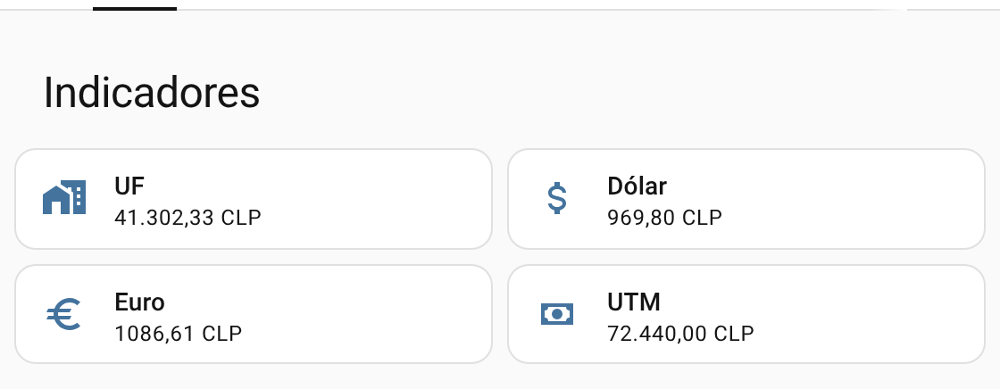

```yaml
type: grid
title: Indicadores
columns: 2
square: false
cards:
  - type: tile
    entity: sensor.indicadores_economicos_uf
    name: UF
    icon: mdi:home-city
  - type: tile
    entity: sensor.indicadores_economicos_dolar_observado
    name: Dólar
    icon: mdi:currency-usd
  - type: tile
    entity: sensor.indicadores_economicos_euro
    name: Euro
    icon: mdi:currency-eur
  - type: tile
    entity: sensor.indicadores_economicos_utm
    name: UTM
    icon: mdi:cash
```

Evolución del dólar en el último mes:

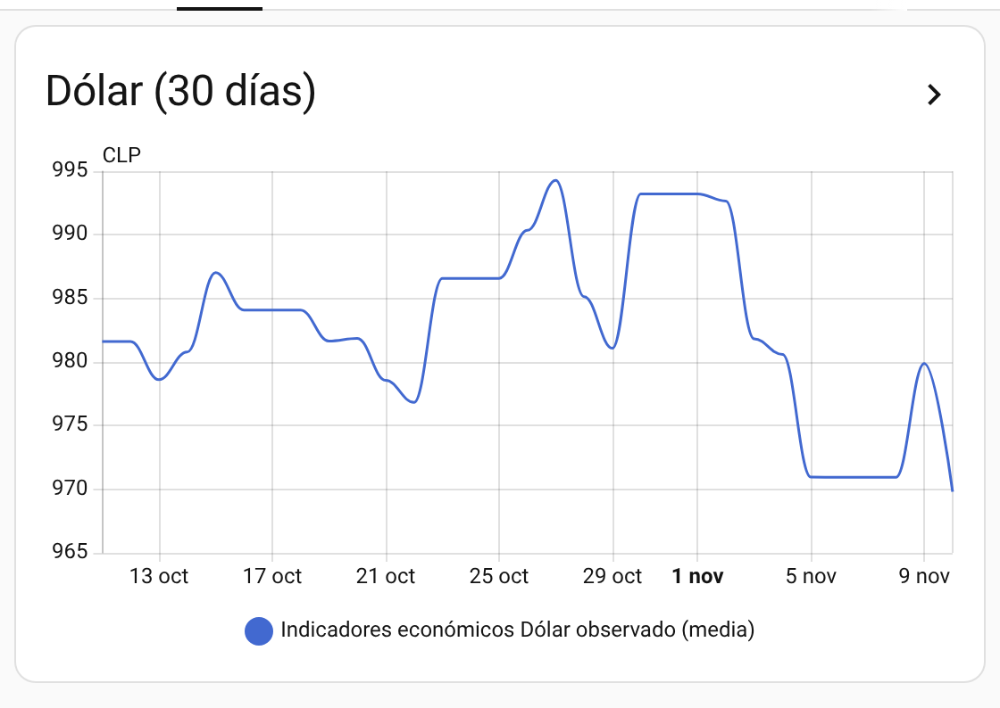

```yaml
type: statistics-graph
title: Dólar (30 días)
entities:
  - sensor.indicadores_economicos_dolar_observado
stat_types:
  - mean
days_to_show: 30
period: day
chart_type: line
```

Con la fecha del valor (atributo `fecha`):

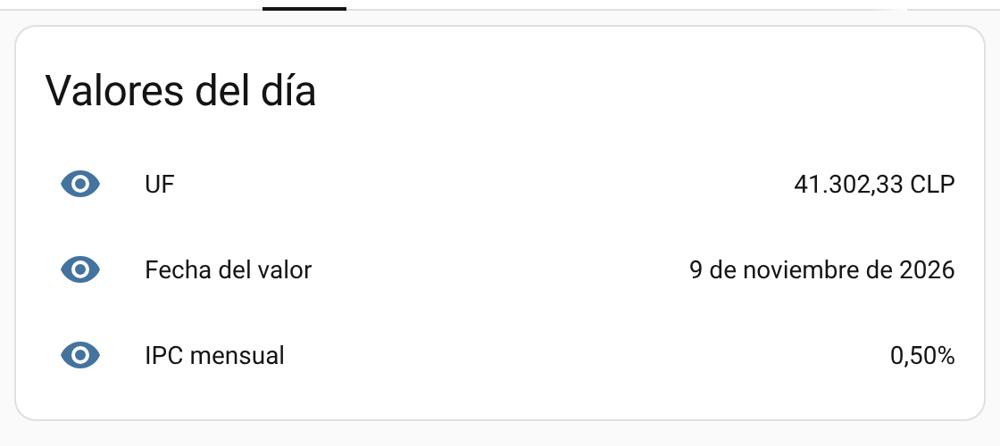

```yaml
type: entities
title: Valores del día
entities:
  - entity: sensor.indicadores_economicos_uf
    name: UF
  - type: attribute
    entity: sensor.indicadores_economicos_uf
    attribute: fecha
    name: Fecha del valor
  - entity: sensor.indicadores_economicos_ipc
    name: IPC mensual
```

### 📈 Bolsa de Santiago (IPSA)

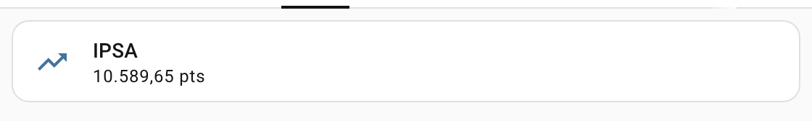

```yaml
type: tile
entity: sensor.bolsa_de_santiago_ipsa
name: IPSA
```

Detalle del cierre:

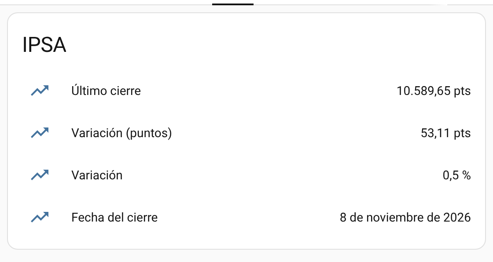

```yaml
type: entities
title: IPSA
entities:
  - entity: sensor.bolsa_de_santiago_ipsa
    name: Último cierre
  - type: attribute
    entity: sensor.bolsa_de_santiago_ipsa
    attribute: variacion_puntos
    name: Variación (puntos)
    suffix: pts
  - type: attribute
    entity: sensor.bolsa_de_santiago_ipsa
    attribute: variacion_pct
    name: Variación
    suffix: "%"
  - type: attribute
    entity: sensor.bolsa_de_santiago_ipsa
    attribute: fecha_cierre
    name: Fecha del cierre
```

### 🪙 Criptomonedas

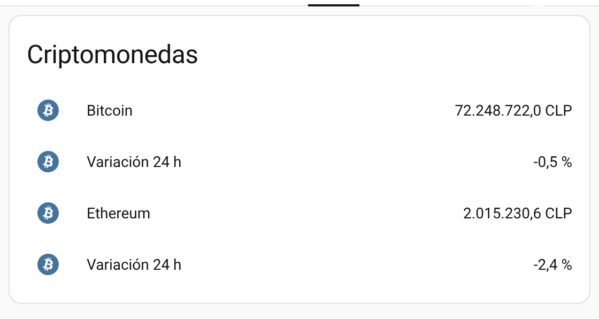

```yaml
type: entities
title: Criptomonedas
entities:
  - entity: sensor.criptomonedas_buda_bitcoin
    name: Bitcoin
  - type: attribute
    entity: sensor.criptomonedas_buda_bitcoin
    attribute: variacion_24h_pct
    name: Variación 24 h
    suffix: "%"
  - entity: sensor.criptomonedas_buda_ethereum
    name: Ethereum
  - type: attribute
    entity: sensor.criptomonedas_buda_ethereum
    attribute: variacion_24h_pct
    name: Variación 24 h
    suffix: "%"
```

### 🚇 Metro de Santiago

Las siete líneas, con el color de cada una:

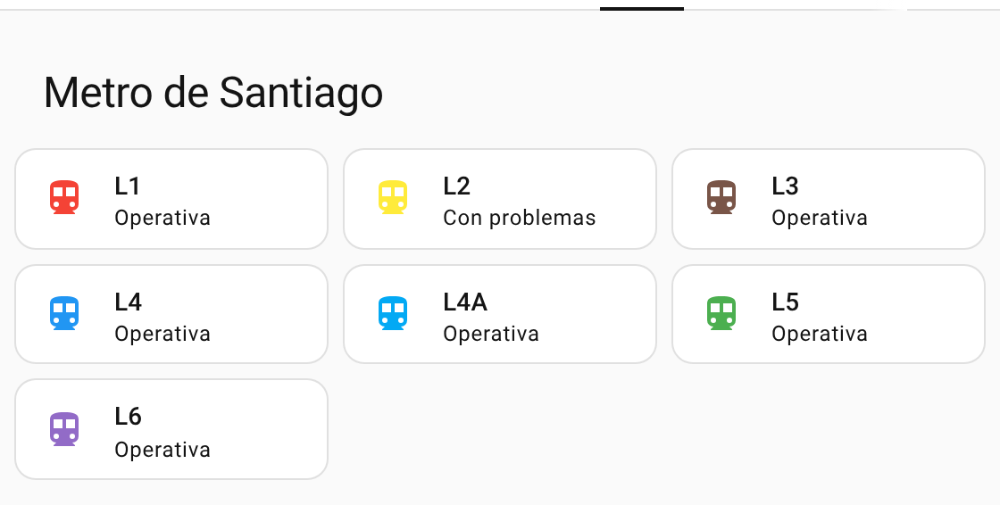

*Ejemplo con un incidente simulado en la Línea 2.*

```yaml
type: grid
title: Metro de Santiago
columns: 3
square: false
cards:
  - type: tile
    entity: sensor.metro_de_santiago_linea_1
    name: L1
    color: red
  - type: tile
    entity: sensor.metro_de_santiago_linea_2
    name: L2
    color: yellow
  - type: tile
    entity: sensor.metro_de_santiago_linea_3
    name: L3
    color: brown
  - type: tile
    entity: sensor.metro_de_santiago_linea_4
    name: L4
    color: blue
  - type: tile
    entity: sensor.metro_de_santiago_linea_4a
    name: L4A
    color: light-blue
  - type: tile
    entity: sensor.metro_de_santiago_linea_5
    name: L5
    color: green
  - type: tile
    entity: sensor.metro_de_santiago_linea_6
    name: L6
    color: purple
```

Resumen con las estaciones afectadas (o el aviso de que el Metro está cerrado):

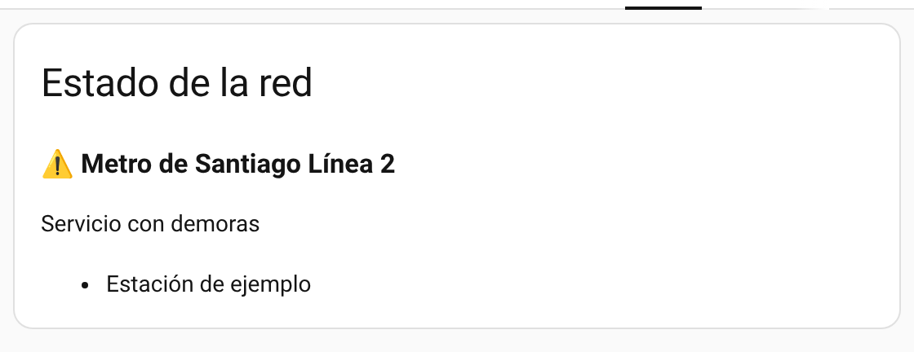

*Ejemplo con un incidente simulado en la Línea 2.*

```yaml
type: markdown
title: Estado de la red
content: |
  
  
  
  
  🌙 **Metro cerrado.** Abre a las {{ lineas[0].attributes.horario_apertura }}.
  
  
  ### ⚠️ {{ l.name }}
  {{ l.attributes.mensaje }}
  - {{ e }}
  
  
  
  ✅ Sin incidentes en la red.
  
  Sin datos del Metro.
  
```

### 🚌 Paraderos

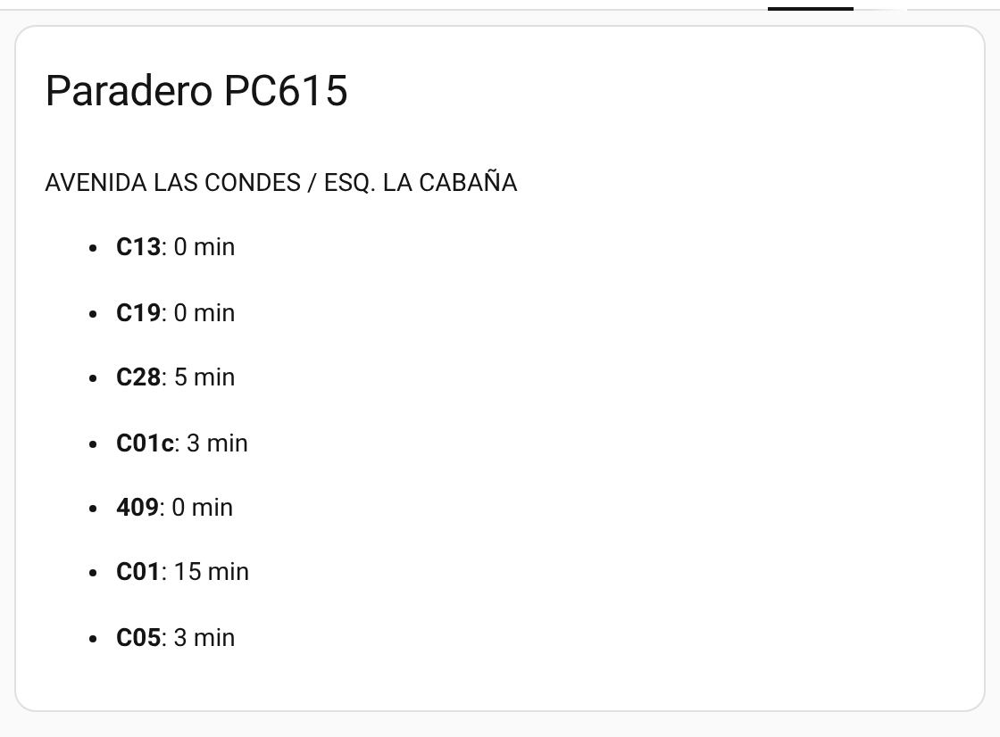

```yaml
type: markdown
title: Paradero PC615
content: |
  
  {{ state_attr('sensor.paraderos_red_movilidad_paradero_pc615', 'nombre') or '' }}

  
  
  - **{{ recorrido }}**: {{ info.minutos }} min
  
  
  No hay buses en camino.
  
```

Varios paraderos de un vistazo:

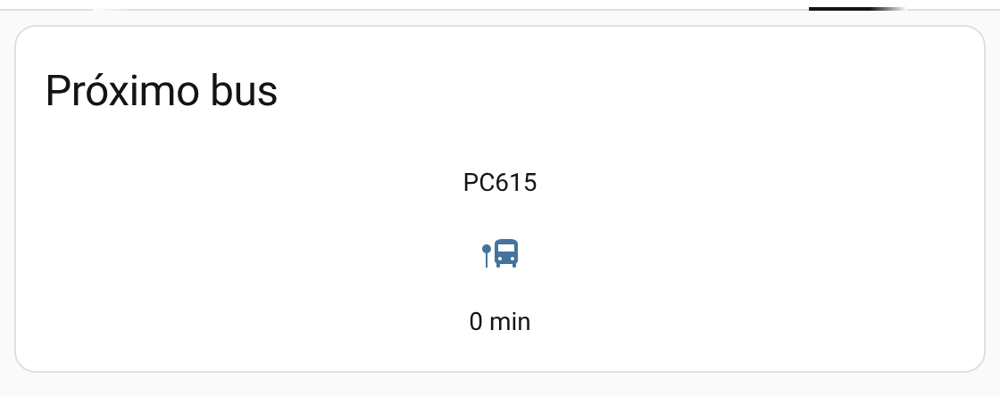

```yaml
type: glance
title: Próximo bus
entities:
  - entity: sensor.paraderos_red_movilidad_paradero_pc615
    name: PC615
```

### 🚍 Paraderos de la Red Regional
Próximas llegadas a un paradero fuera de Santiago (cambia la ciudad y el código por los tuyos).

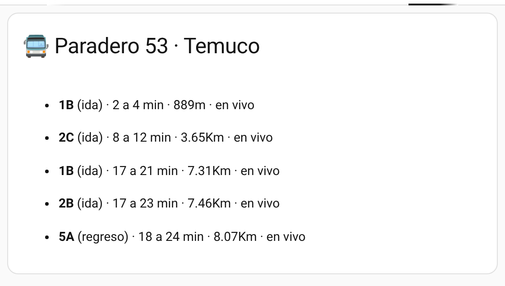

```yaml
type: markdown
title: 🚍 Paradero 53 · Temuco
content: |
  
  
  Sin buses próximos.
  
  
  - **{{ b.servicio }}** ({{ b.sentido }}) · {{ b.estimacion }} · {{ b.distancia }}{{ ' · en vivo' if b.tiempo_real }}
  
  
  
  ⚠️ {{ a }}
  
```

### 🌋 Sismos

Mapa del último sismo (USGS trae las coordenadas):

```yaml
type: map
title: Último sismo
entities:
  - entity: sensor.sismos_chile_ultimo_sismo_con_coordenadas_usgs
    label_mode: state
default_zoom: 6
```

Último sismo del Centro Sismológico Nacional, en palabras:

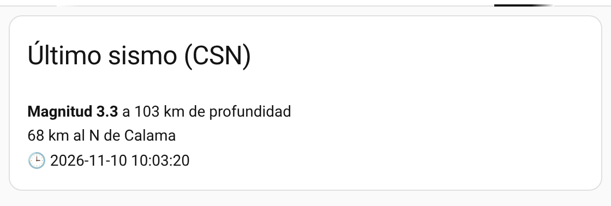

```yaml
type: markdown
title: Último sismo (CSN)
content: |
  **Magnitud {{ states('sensor.sismos_chile_ultimo_sismo_csn') }}** a {{ state_attr('sensor.sismos_chile_ultimo_sismo_csn', 'profundidad_km') | int(0) }} km de profundidad  
  {{ state_attr('sensor.sismos_chile_ultimo_sismo_csn', 'referencia') }}  
  🕒 {{ state_attr('sensor.sismos_chile_ultimo_sismo_csn', 'fecha') }}
```

### 📅 Feriados

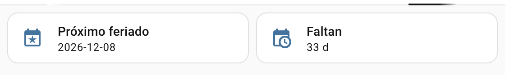

```yaml
type: grid
columns: 2
square: false
cards:
  - type: tile
    entity: sensor.feriados_chile_proximo_feriado
    name: Próximo feriado
    icon: mdi:calendar-star
  - type: tile
    entity: sensor.feriados_chile_dias_para_el_proximo_feriado
    name: Faltan
    icon: mdi:calendar-clock
```

Con el nombre del feriado:

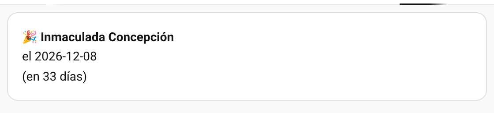

```yaml
type: markdown
content: |
  🎉 **{{ state_attr('sensor.feriados_chile_proximo_feriado', 'nombre') }}**
  el {{ states('sensor.feriados_chile_proximo_feriado') }}
  (en {{ states('sensor.feriados_chile_dias_para_el_proximo_feriado') }} días)
  · irrenunciable
```

### 🌫️ Calidad del aire y UV

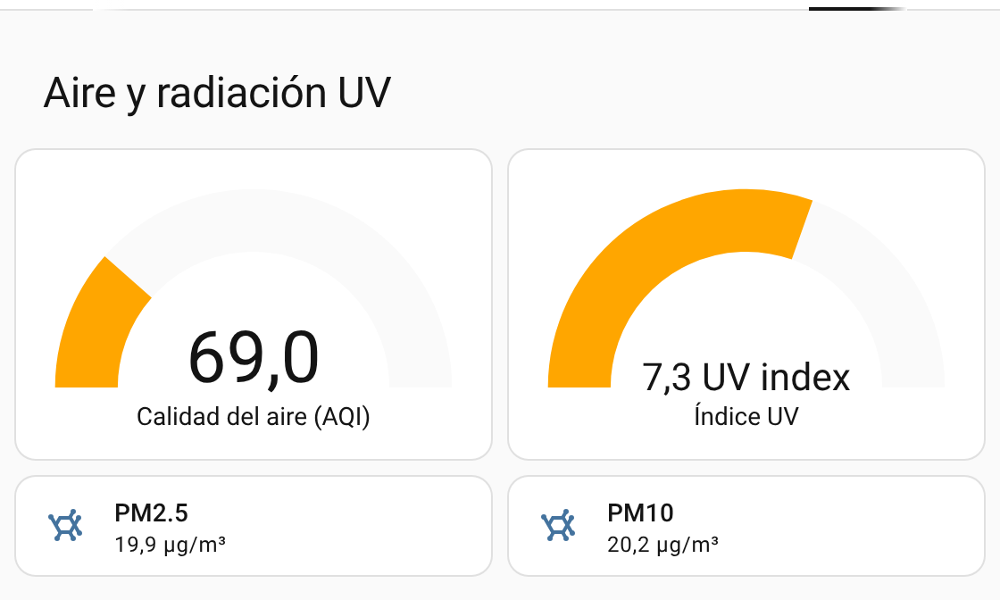

```yaml
type: grid
title: Aire y radiación UV
columns: 2
square: false
cards:
  - type: gauge
    entity: sensor.calidad_del_aire_y_uv_indice_de_calidad_del_aire_us_aqi
    name: Calidad del aire (AQI)
    min: 0
    max: 300
    severity:
      green: 0
      yellow: 51
      red: 101
  - type: gauge
    entity: sensor.calidad_del_aire_y_uv_indice_uv
    name: Índice UV
    min: 0
    max: 12
    severity:
      green: 0
      yellow: 3
      red: 8
  - type: tile
    entity: sensor.calidad_del_aire_y_uv_pm2_5
    name: PM2.5
  - type: tile
    entity: sensor.calidad_del_aire_y_uv_pm10
    name: PM10
```

### 💊 Farmacias de turno

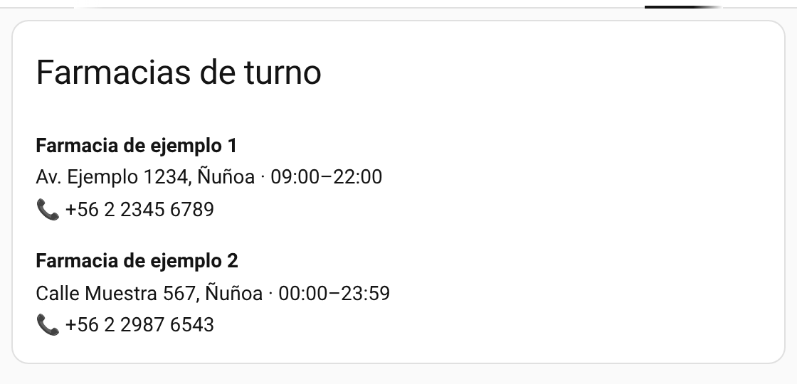

*Datos de ejemplo.*

```yaml
type: markdown
title: Farmacias de turno
content: |
  
  
  
  **{{ x.nombre }}**  
  {{ x.direccion }} · {{ x.apertura }}–{{ x.cierre }}  
  📞 {{ x.telefono }}

  
  
  Sin farmacias de turno registradas hoy.
  
```

### 🎬 Cine

Cartelera de hoy con el póster de cada película (el ejemplo muestra las 6 primeras; quita `[:6]` para verlas todas):

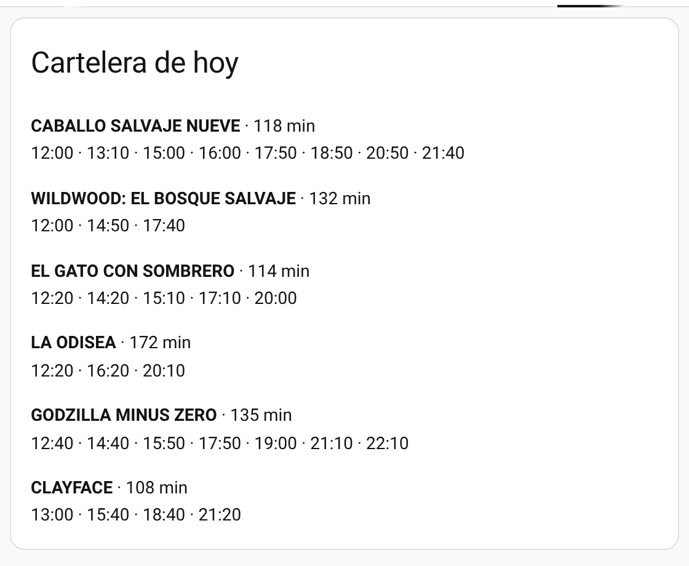

```yaml
type: markdown
title: Cartelera de hoy
content: |
  <table>
  
  <tr>
  <td></td>
  <td><b>{{ m.titulo }}</b> · {{ m.duracion_min }} min<br>{{ m.funciones | map(attribute='hora') | join(' · ') }}</td>
  </tr>
  
  </table>
```

Próxima función con su póster:

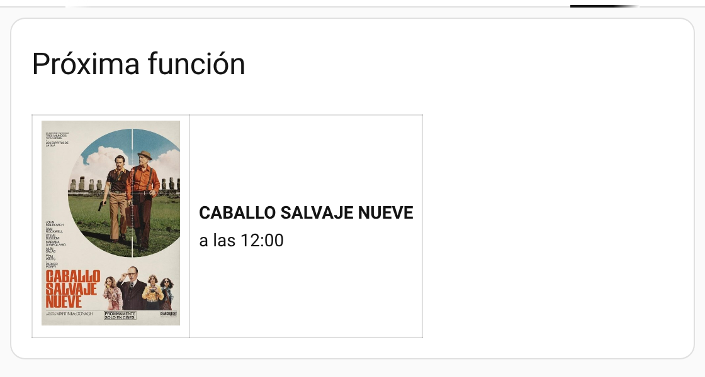

```yaml
type: markdown
title: Próxima función
content: |
  
  
  <table>
  <tr>
  <td></td>
  <td><b>{{ n.titulo }}</b><br>a las {{ n.hora }}</td>
  </tr>
  </table>
  
  Hoy no quedan más funciones.
  
```

El sensor también entrega el póster de la próxima función como imagen de la entidad, así que las tarjetas que muestran la
imagen de una entidad (como `tile`) lo usan directamente:

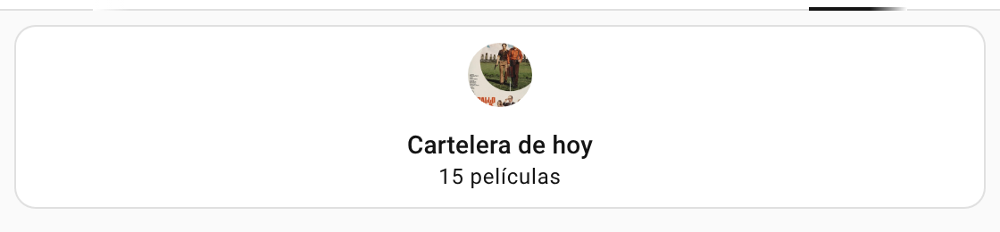

```yaml
type: tile
entity: sensor.cinemark_alto_las_condes_cartelera_de_hoy
name: Cartelera de hoy
show_entity_picture: true
vertical: true
```

Versión corta (texto ya armado por la integración) y próxima función:

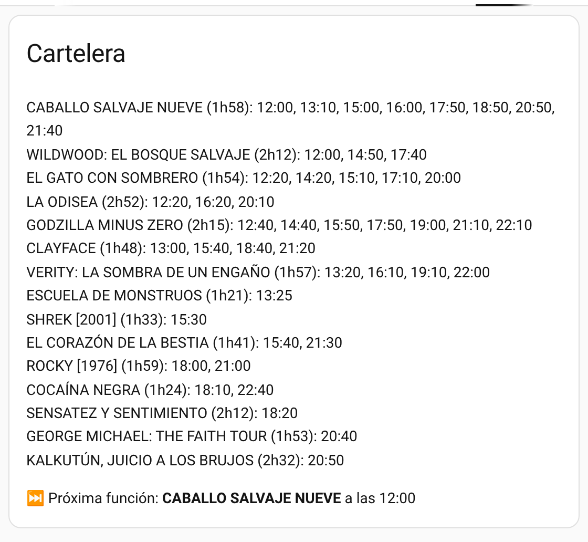

```yaml
type: markdown
title: Cartelera
content: |
  {{ state_attr('sensor.cinemark_alto_las_condes_cartelera_de_hoy', 'resumen') }}

  
  ⏭️ Próxima función: **{{ n.titulo }}** a las {{ n.hora }}
```

### 🇨🇱 Efemérides

Las de hoy, con su fuente:

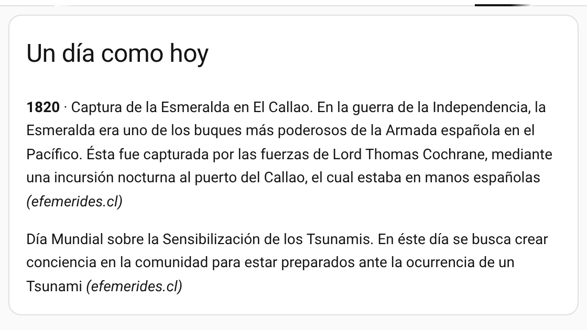

```yaml
type: markdown
title: Un día como hoy
content: |
  
  **{{ e.anio }}** · {{ e.texto }} _({{ e.fuente }})_

  
  Sin efemérides chilenas registradas para hoy.
  
```

Próximo día significativo:

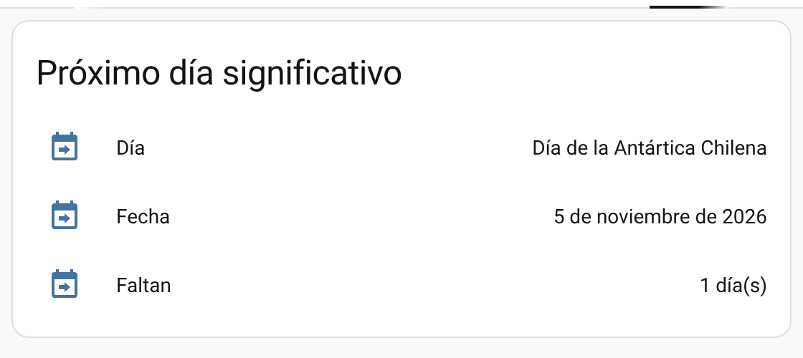

```yaml
type: entities
title: Próximo día significativo
entities:
  - entity: sensor.efemerides_chilenas_proximo_dia_significativo
    name: Día
  - type: attribute
    entity: sensor.efemerides_chilenas_proximo_dia_significativo
    attribute: fecha
    name: Fecha
  - type: attribute
    entity: sensor.efemerides_chilenas_proximo_dia_significativo
    attribute: dias_restantes
    name: Faltan
    suffix: día(s)
```

### ✝️ Santoral

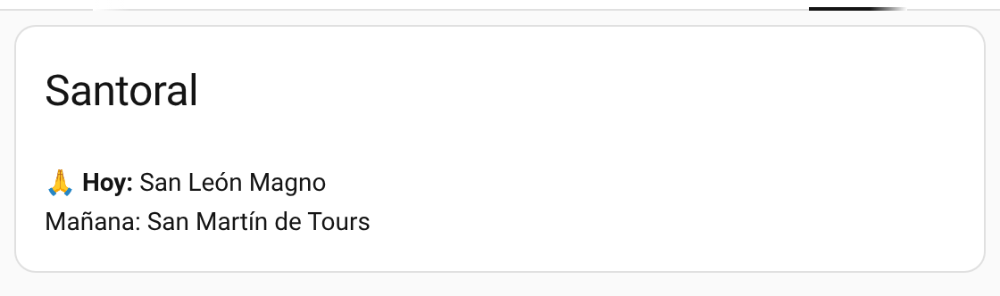

```yaml
type: markdown
title: Santoral
content: |
  🙏 **Hoy:** {{ states('sensor.santoral_santo_del_dia') }}  
  Mañana: {{ state_attr('sensor.santoral_santo_del_dia', 'mañana') }}
```

### ⚽ Fútbol

Tu equipo: próximo partido, último resultado y posición en la tabla (cambia `colo_colo` por tu equipo):

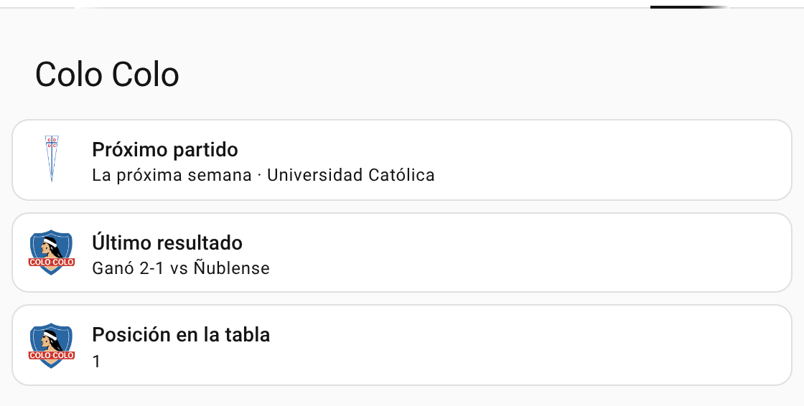

```yaml
type: grid
title: Colo Colo
columns: 1
square: false
cards:
  - type: tile
    entity: sensor.futbol_colo_colo_proximo_partido
    name: Próximo partido
    show_entity_picture: true
    state_content:
      - state
      - rival
  - type: tile
    entity: sensor.futbol_colo_colo_ultimo_resultado
    name: Último resultado
    show_entity_picture: true
  - type: tile
    entity: sensor.futbol_colo_colo_posicion_en_la_tabla
    name: Posición en la tabla
    show_entity_picture: true
```

Más detalle del próximo partido y de la campaña:

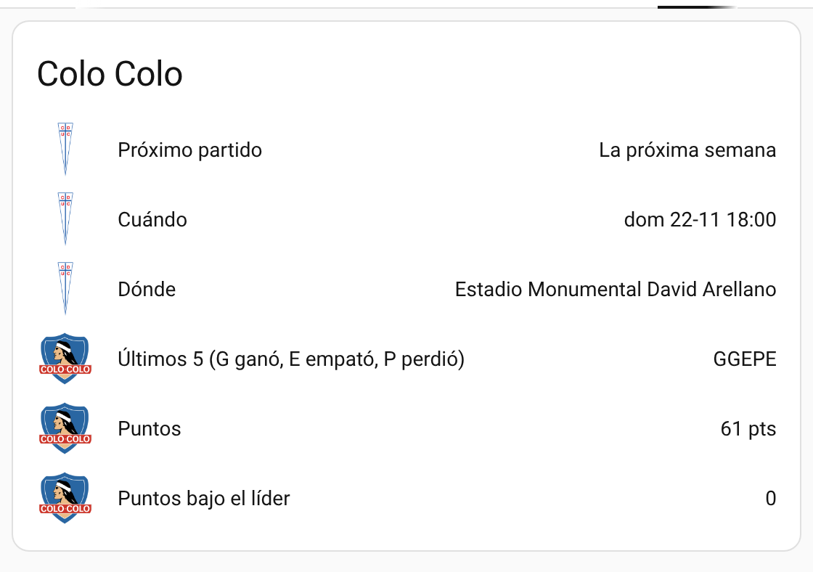

```yaml
type: entities
title: Colo Colo
entities:
  - entity: sensor.futbol_colo_colo_proximo_partido
    name: Próximo partido
  - type: attribute
    entity: sensor.futbol_colo_colo_proximo_partido
    attribute: hora_local
    name: Cuándo
  - type: attribute
    entity: sensor.futbol_colo_colo_proximo_partido
    attribute: estadio
    name: Dónde
  - type: attribute
    entity: sensor.futbol_colo_colo_ultimo_resultado
    attribute: forma
    name: Últimos 5 (G ganó, E empató, P perdió)
  - type: attribute
    entity: sensor.futbol_colo_colo_posicion_en_la_tabla
    attribute: puntos
    name: Puntos
    suffix: pts
  - type: attribute
    entity: sensor.futbol_colo_colo_posicion_en_la_tabla
    attribute: puntos_bajo_el_lider
    name: Puntos bajo el líder
```

Los partidos de la próxima fecha de la Primera División:

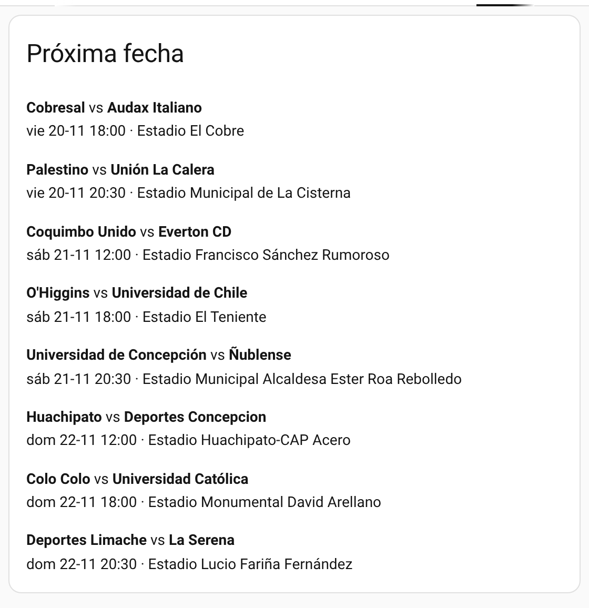

```yaml
type: markdown
title: Próxima fecha
content: |
  
  **{{ p.local }}** vs **{{ p.visita }}**  
  {{ p.hora_local }} · {{ p.estadio }}

  
  No hay partidos programados.
  
```

Resultados de la última fecha:

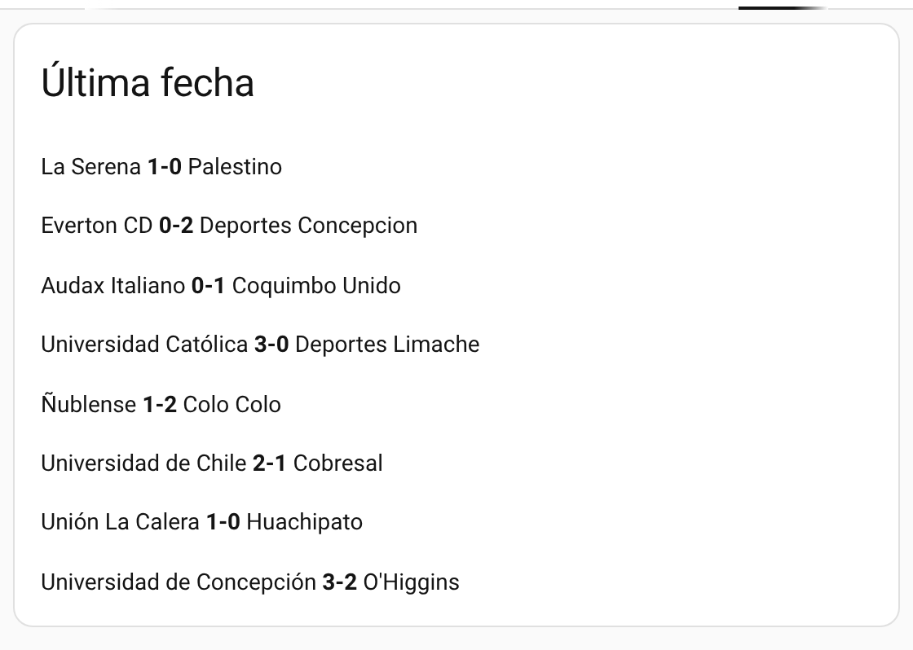

```yaml
type: markdown
title: Última fecha
content: |
  
  {{ r.local }} **{{ r.marcador }}** {{ r.visita }}  
  
```

Tabla de posiciones (los 8 primeros):

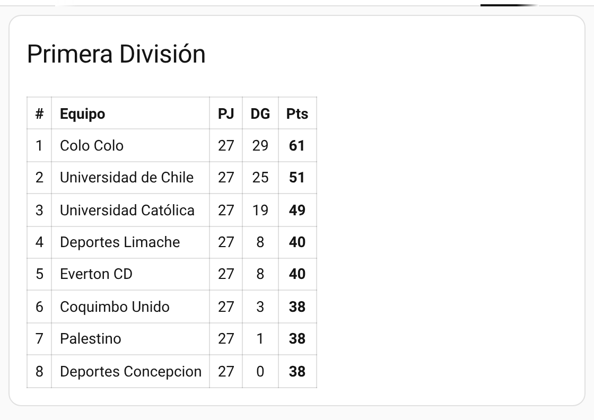

```yaml
type: markdown
title: Primera División
content: |
  | # | Equipo | PJ | DG | Pts |
  |:-:|:--|:-:|:-:|:-:|
  
  | {{ f.posicion }} | {{ f.equipo }} | {{ f.pj }} | {{ f.dg }} | **{{ f.pts }}** |
  
```

La Roja:

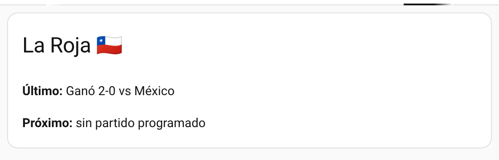

```yaml
type: markdown
title: La Roja 🇨🇱
content: |
  
  **Último:** {{ states('sensor.futbol_la_roja_ultimo_resultado') }}  
  
  **Próximo:** vs {{ state_attr(n, 'rival') }} — {{ state_attr(n, 'hora_local') }} ({{ state_attr(n, 'competencia') }})
  
  **Próximo:** sin partido programado
  
```

### ⛽ Combustibles

La bencina y el diésel más baratos cerca de tu casa, con la marca de la estación:

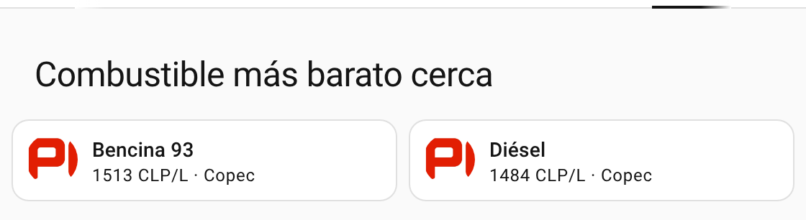

```yaml
type: grid
title: Combustible más barato cerca
columns: 2
square: false
cards:
  - type: tile
    entity: sensor.combustibles_gasolina_93_mas_barata
    name: Bencina 93
    show_entity_picture: true
    state_content:
      - state
      - marca
  - type: tile
    entity: sensor.combustibles_diesel_mas_barato
    name: Diésel
    show_entity_picture: true
    state_content:
      - state
      - marca
```

Las 5 estaciones más baratas de bencina 93:

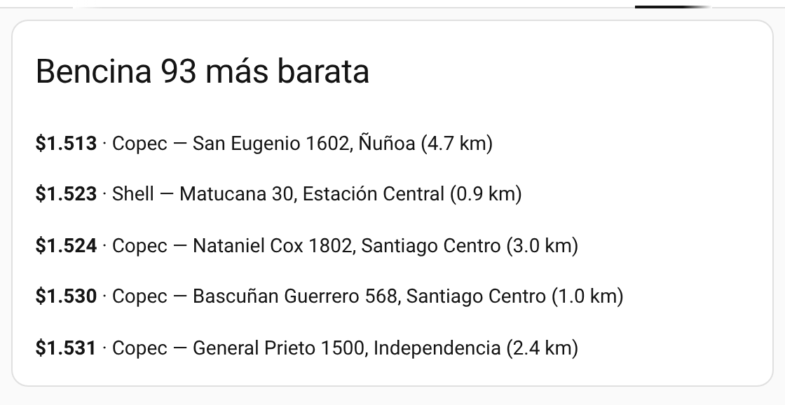

```yaml
type: markdown
title: Bencina 93 más barata
content: |
  
  **${{ '{:,.0f}'.format(e.precio) | replace(',', '.') }}** · {{ e.marca }} — {{ e.direccion }}, {{ e.comuna }} ({{ e.distancia_km }} km)  
  
  No hay estaciones con precio vigente cerca.
  
```

Precio, promedio de la zona y cuántas estaciones hay:

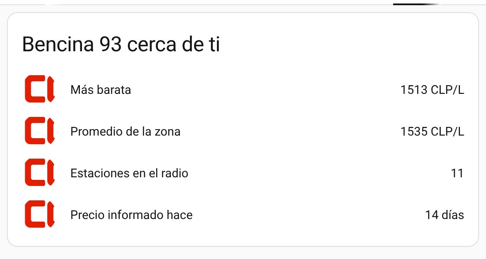

```yaml
type: entities
title: Bencina 93 cerca de ti
entities:
  - entity: sensor.combustibles_gasolina_93_mas_barata
    name: Más barata
  - type: attribute
    entity: sensor.combustibles_gasolina_93_mas_barata
    attribute: promedio_en_radio
    name: Promedio de la zona
    suffix: CLP/L
  - type: attribute
    entity: sensor.combustibles_gasolina_93_mas_barata
    attribute: estaciones_en_radio
    name: Estaciones en el radio
  - type: attribute
    entity: sensor.combustibles_gasolina_93_mas_barata
    attribute: antiguedad_dias
    name: Precio informado hace
    suffix: días
```

### 💳 Descuentos de tus tarjetas
Lista de los descuentos de hoy en una categoría (cambia `comida` por `combustibles`, `salud_y_belleza`, etc.).

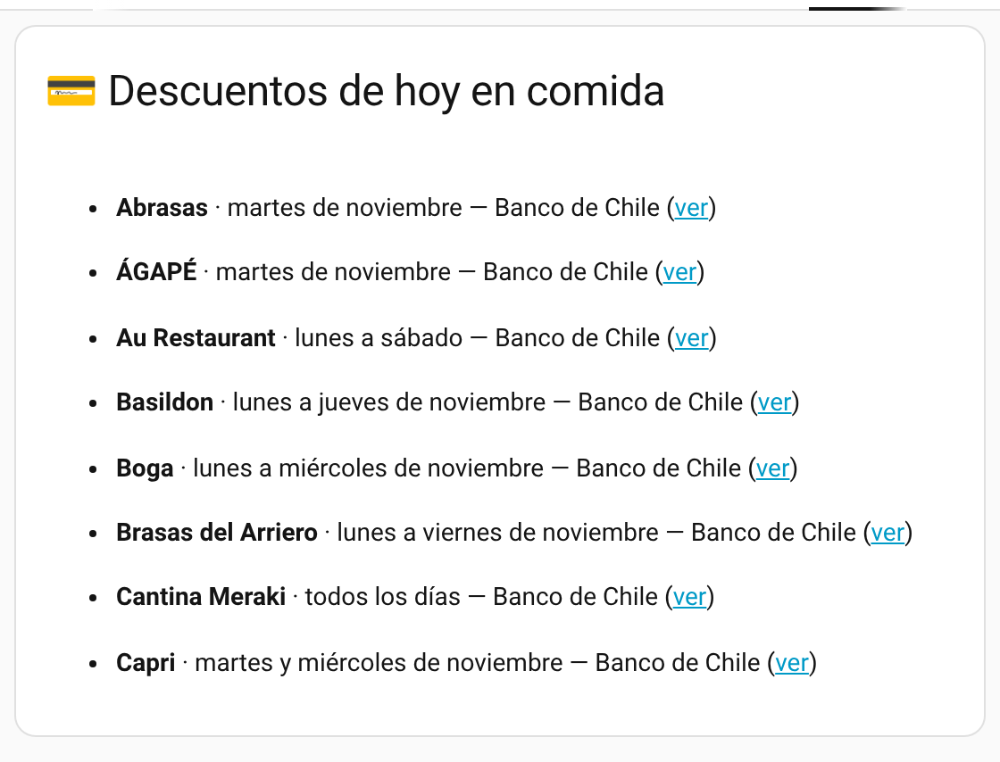

```yaml
type: markdown
title: 💳 Descuentos de hoy en comida
content: |
  
  
  Hoy no hay descuentos de tus tarjetas en esta categoría.
  
  
  - **{{ b.comercio }}** · {{ b.descuento }} — {{ b.tarjeta }} ([ver]({{ b.url }}))
  
  
```

Aviso en el celular cuando hay descuentos (automatización):

```yaml
alias: Descuentos de hoy en combustibles
triggers:
  - trigger: state
    entity_id: sensor.descuentos_de_tarjetas_descuentos_de_hoy_combustibles
conditions:
  - condition: numeric_state
    entity_id: sensor.descuentos_de_tarjetas_descuentos_de_hoy_combustibles
    above: 0
actions:
  - action: notify.notify          # cambia por tu servicio, p. ej. notify.mobile_app_mi_celular
    data:
      title: 💳 Descuentos de hoy
      message: |
        
        {{ b.comercio }}: {{ b.descuento }} ({{ b.tarjeta }})
        
```

### 📰 Noticias por tema
Titulares de un tema con enlace a la nota (cambia `nacional` por `politica`, `mundo`, `economia`, `deportes`…).

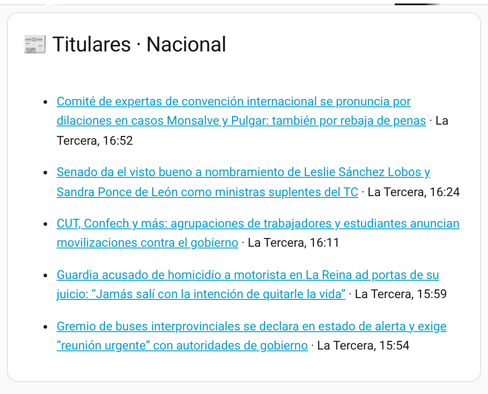

```yaml
type: markdown
title: 📰 Titulares · Nacional
content: |
  
  - [{{ n.titulo }}]({{ n.enlace }}) · {{ n.medio }}, {{ n.hora[-5:] }}
  
```

### 🚗 Mi vehículo

Restricción de hoy, dígitos restringidos, próxima fecha y mes de revisión técnica:

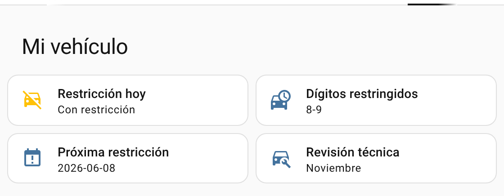

*Ejemplo con fecha simulada: lunes 8 de junio de 2026, dentro de la temporada de restricción (hoy no hay restricción).*

```yaml
type: grid
title: Mi vehículo
columns: 2
square: false
cards:
  - type: tile
    entity: binary_sensor.mi_vehiculo_restriccion_vehicular_hoy
    name: Restricción hoy
  - type: tile
    entity: sensor.mi_vehiculo_digitos_con_restriccion_hoy
    name: Dígitos restringidos
  - type: tile
    entity: sensor.mi_vehiculo_proxima_restriccion
    name: Próxima restricción
  - type: tile
    entity: sensor.mi_vehiculo_mes_de_revision_tecnica
    name: Revisión técnica
```

Aviso en palabras:

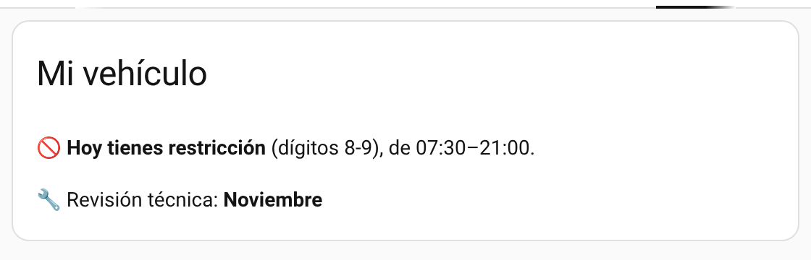

*Ejemplo con fecha simulada: lunes 8 de junio de 2026, dentro de la temporada de restricción (hoy no hay restricción).*

```yaml
type: markdown
title: Mi vehículo
content: |
  
  
  🚫 **Hoy tienes restricción** (dígitos {{ state_attr(r, 'digitos_hoy') }}), de {{ state_attr(r, 'horario') }}.
  
  ✅ **Hoy no tienes restricción.** {{ state_attr(r, 'motivo') }}.
  
  Sin datos de restricción para hoy.
  

  🔧 Revisión técnica: **{{ states('sensor.mi_vehiculo_mes_de_revision_tecnica') }}** (¡te toca este mes!)
```

### ☀️ Resumen del día (todo junto)

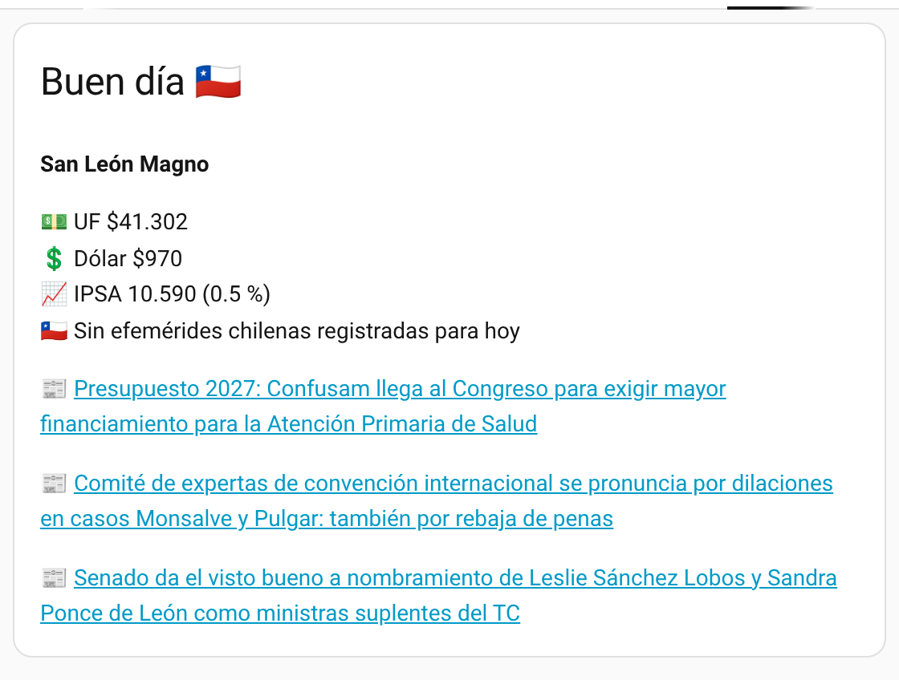

```yaml
type: markdown
title: Buen día 🇨🇱
content: |
  **{{ states('sensor.santoral_santo_del_dia') }}**

  💵 UF ${{ '{:,.0f}'.format(states('sensor.indicadores_economicos_uf') | float(0)) | replace(',', '.') }}  
  💲 Dólar ${{ '{:,.0f}'.format(states('sensor.indicadores_economicos_dolar_observado') | float(0)) | replace(',', '.') }}  
  📈 IPSA {{ '{:,.0f}'.format(states('sensor.bolsa_de_santiago_ipsa') | float(0)) | replace(',', '.') }} ({{ state_attr('sensor.bolsa_de_santiago_ipsa', 'variacion_pct') }} %)  
  🇨🇱 {{ states('sensor.efemerides_chilenas_efemerides_de_hoy') }}

  
  📰 [{{ n.titulo }}]({{ n.enlace }})  
  
```

### 🌅 Resumen de la mañana en tu celular
Una notificación diaria que junta lo que ya tienes en Navaja Chilena: el santo, UF y dólar, si hoy tienes restricción vehicular, los descuentos en bencina de tus
tarjetas, el próximo feriado y tres titulares. Solo aparece lo que corresponde: si hoy no tienes restricción ni descuentos, esas líneas no salen.

```yaml
alias: Resumen de la mañana
triggers:
  - trigger: time
    at: "07:30:00"
actions:
  - action: notify.notify          # cambia por tu servicio, p. ej. notify.mobile_app_mi_celular
    data:
      title: "🇨🇱 Buen día{{ ' · ' ~ states('sensor.santoral_santo_del_dia') if has_value('sensor.santoral_santo_del_dia') }}"
      message: |
        
        💵 UF ${{ '{:,.0f}'.format(states('sensor.indicadores_economicos_uf') | float(0)) | replace(',', '.') }} · Dólar ${{ '{:,.0f}'.format(states('sensor.indicadores_economicos_dolar_observado') | float(0)) | replace(',', '.') }}
        
        
        🚗 Hoy tienes restricción vehicular ({{ state_attr('binary_sensor.mi_vehiculo_restriccion_vehicular_hoy', 'horario') }})
        
        
        ⛽ Bencina con descuento hoy: {{ d.tarjeta }} en {{ d.estaciones | join('/') }} ({{ d.descuento }}){{ ', ' if not loop.last }}
        
        
        🎉 Hoy es feriado: {{ state_attr('sensor.feriados_chile_proximo_feriado', 'nombre') }}
        
        📅 Próximo feriado: {{ state_attr('sensor.feriados_chile_proximo_feriado', 'nombre') }} (en {{ states('sensor.feriados_chile_dias_para_el_proximo_feriado') }} días)
        
        
        📰 {{ n.titulo }}
        
```

Cada línea aparece solo si ese módulo está activado: el resumen se arma con lo que tú elegiste. Los nombres de las entidades son los de tu instalación; si
cambiaste alguno, ajústalo en la plantilla.

## Fuentes de datos y créditos

Navaja Chilena reúne información publicada por servicios públicos y abiertos. Todos se consultan con moderación y sin
necesidad de registrarte.

| Módulo | Fuente |
|---|---|
| Indicadores económicos e IPSA | [mindicador.cl](https://mindicador.cl) y [findic.cl](https://findic.cl) |
| Metro y paraderos | [api.xor.cl](https://api.xor.cl) (datos del Metro de Santiago y de Red Movilidad) |
| Sismos | Centro Sismológico Nacional (vía api.gael.cloud) y [USGS](https://earthquake.usgs.gov) |
| Feriados | [boostr.cl](https://api.boostr.cl) |
| Calidad del aire y UV | [Open-Meteo](https://open-meteo.com) |
| Farmacias de turno | Ministerio de Salud, [Farmanet](https://www.minsal.cl/farmanet/) |
| Cartelera de cine | [Cinemark Chile](https://www.cinemark.cl) |
| Efemérides | [efemerides.cl](https://www.efemerides.cl) y [Wikipedia en español](https://es.wikipedia.org) |
| Fútbol | [ESPN](https://www.espn.cl/futbol/) (calendario, resultados y tabla; servicio público no documentado) |
| Combustibles | [Bencina en Línea](https://www.bencinaenlinea.cl) (Comisión Nacional de Energía) |
| Descuentos en bencina | Calendario mensual del repositorio ([`data/bencina.json`](data/bencina.json)); cada descuento cita su fuente (Copec, Shell, Aramco, bancos y prensa) |
| Descuentos de tarjetas | [N Beneficios](https://www.nbeneficios.cl), un servicio de Infoacción (los beneficios, logos e imágenes pertenecen a sus emisores) |
| Noticias por tema | Feeds RSS públicos de [La Tercera](https://www.latercera.com) y [Cooperativa.cl](https://www.cooperativa.cl); los titulares enlazan a las notas originales y su contenido pertenece a sus autores |
| Paraderos de la Red Regional | TransApp / DTPR (servicio no oficial). Referencia de la API: [edwinroket/red-regional-api](https://github.com/edwinroket/red-regional-api) y [frabarz/hass-red-regional](https://github.com/frabarz/hass-red-regional) (integración para Home Assistant, licencia MIT); este módulo es una implementación propia |
| Restricción vehicular | [Ministerio de Transportes](https://mtt.gob.cl/restriccion-vehicular-2026/): Resolución Exenta N° 1698/2026 (Seremi RM) |
| Revisión técnica | [ChileAtiende](https://www.chileatiende.gob.cl/fichas/23978) (Subsecretaría de Transportes) |
| Criptomonedas | [Buda.com](https://www.buda.com) |

Los textos de Wikipedia están bajo licencia [CC BY-SA 4.0](https://creativecommons.org/licenses/by-sa/4.0/deed.es); cada
efeméride indica su fuente y enlaza a su artículo. Los nombres y marcas pertenecen a sus respectivos titulares; Navaja Chilena
es un proyecto independiente y no está afiliado a ninguno de ellos.

### Agradecimientos

Los paraderos de la Red Regional se apoyan en el trabajo de reverse engineering de [edwinroket/red-regional-api](https://github.com/edwinroket/red-regional-api) (documentación de la API y SDK) y en
[frabarz/hass-red-regional](https://github.com/frabarz/hass-red-regional), la integración de Home Assistant que lo llevó a la plataforma (licencia MIT). Si lo que necesitas son
solo esos paraderos, con mapa de buses en vivo, esa integración es una excelente opción. Gracias a ambos por abrir el camino.

## Si vienes de la versión 1.x

La versión 2 usa otros nombres de entidad y una configuración renovada. Tras actualizar desde HACS (*⋮ → Volver a descargar*)
y reiniciar, elimina la integración en *Dispositivos y servicios* y vuelve a añadirla. Las tarjetas que usaban
`sensor.navaja_*` o `sensor.metro_l1` deben apuntar a los ids nuevos.

## Contribuir

¿Encontraste un error o tienes una idea? Abre un [issue](https://github.com/Ctuna89/navaja-chilena-HA/issues). Para probar el código:

```bash
pip install pytest-homeassistant-custom-component
pytest
```

## Licencia

Distribuido bajo la licencia incluida en [LICENSE](LICENSE).
