# Tarjetas de ejemplo 🇨🇱

[← Volver al README](../README.md)

Listas para copiar y pegar: usan solo tarjetas que ya trae Home Assistant, sin instalar nada extra. Las imágenes son
capturas reales de Home Assistant (los valores cambian con el tiempo). En tu panel pulsa
*⋮ → Editar panel → Añadir tarjeta → Manual* y pega el YAML. Reemplaza el cine, la comuna y los paraderos de los ejemplos
por los tuyos (los ids los ves en *Ajustes → Dispositivos y servicios → Navaja Chilena*).

> Consejo: en GitHub, el botón de esquema (arriba a la derecha de este archivo) te lleva directo a cada módulo.

## 💰 Indicadores económicos

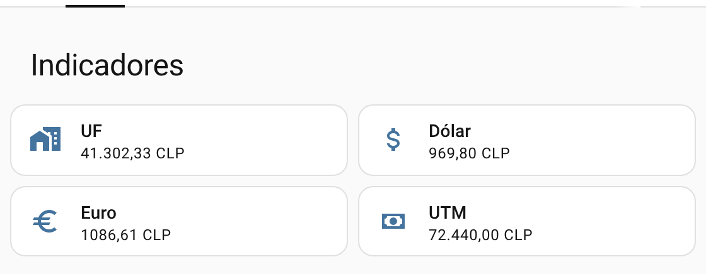

```yaml
type: grid
title: Indicadores
columns: 2
square: false
cards:
  - type: tile
    entity: sensor.indicadores_economicos_uf
    name: UF
    icon: mdi:home-city
  - type: tile
    entity: sensor.indicadores_economicos_dolar_observado
    name: Dólar
    icon: mdi:currency-usd
  - type: tile
    entity: sensor.indicadores_economicos_euro
    name: Euro
    icon: mdi:currency-eur
  - type: tile
    entity: sensor.indicadores_economicos_utm
    name: UTM
    icon: mdi:cash
```

Evolución del dólar en el último mes:

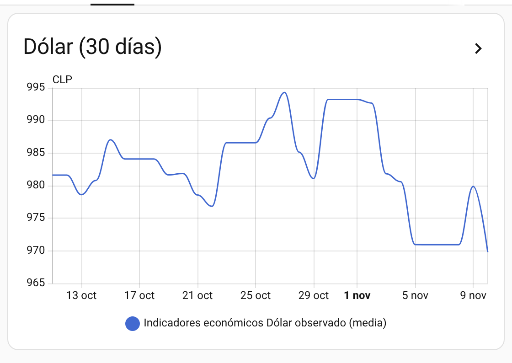

```yaml
type: statistics-graph
title: Dólar (30 días)
entities:
  - sensor.indicadores_economicos_dolar_observado
stat_types:
  - mean
days_to_show: 30
period: day
chart_type: line
```

Con la fecha del valor (atributo `fecha`):

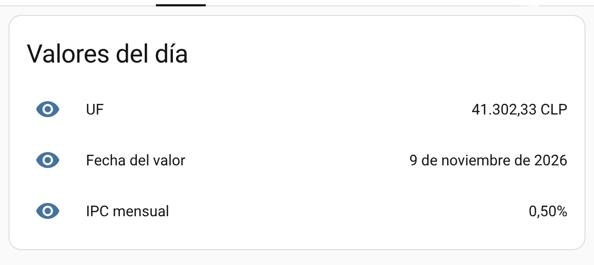

```yaml
type: entities
title: Valores del día
entities:
  - entity: sensor.indicadores_economicos_uf
    name: UF
  - type: attribute
    entity: sensor.indicadores_economicos_uf
    attribute: fecha
    name: Fecha del valor
  - entity: sensor.indicadores_economicos_ipc
    name: IPC mensual
```

## 📈 Bolsa de Santiago (IPSA)

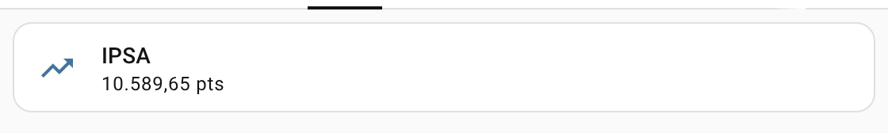

```yaml
type: tile
entity: sensor.bolsa_de_santiago_ipsa
name: IPSA
```

Detalle del cierre:

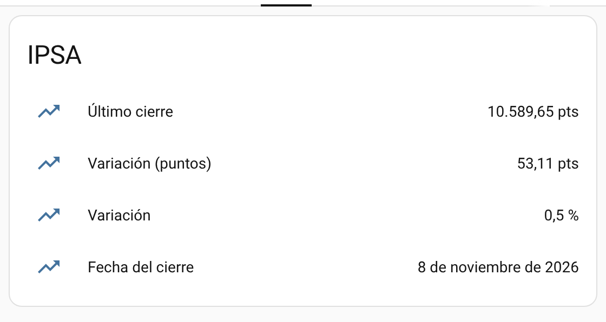

```yaml
type: entities
title: IPSA
entities:
  - entity: sensor.bolsa_de_santiago_ipsa
    name: Último cierre
  - type: attribute
    entity: sensor.bolsa_de_santiago_ipsa
    attribute: variacion_puntos
    name: Variación (puntos)
    suffix: pts
  - type: attribute
    entity: sensor.bolsa_de_santiago_ipsa
    attribute: variacion_pct
    name: Variación
    suffix: "%"
  - type: attribute
    entity: sensor.bolsa_de_santiago_ipsa
    attribute: fecha_cierre
    name: Fecha del cierre
```

## 🪙 Criptomonedas

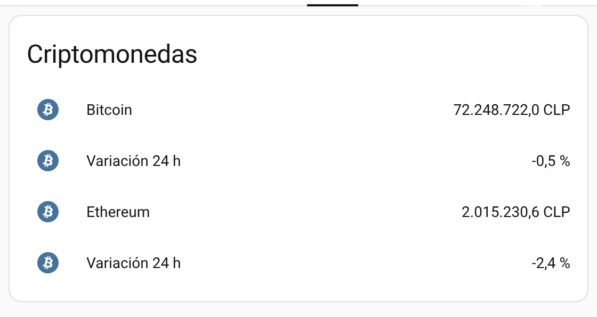

```yaml
type: entities
title: Criptomonedas
entities:
  - entity: sensor.criptomonedas_buda_bitcoin
    name: Bitcoin
  - type: attribute
    entity: sensor.criptomonedas_buda_bitcoin
    attribute: variacion_24h_pct
    name: Variación 24 h
    suffix: "%"
  - entity: sensor.criptomonedas_buda_ethereum
    name: Ethereum
  - type: attribute
    entity: sensor.criptomonedas_buda_ethereum
    attribute: variacion_24h_pct
    name: Variación 24 h
    suffix: "%"
```

## 🚇 Metro de Santiago

Las siete líneas, con el color de cada una:

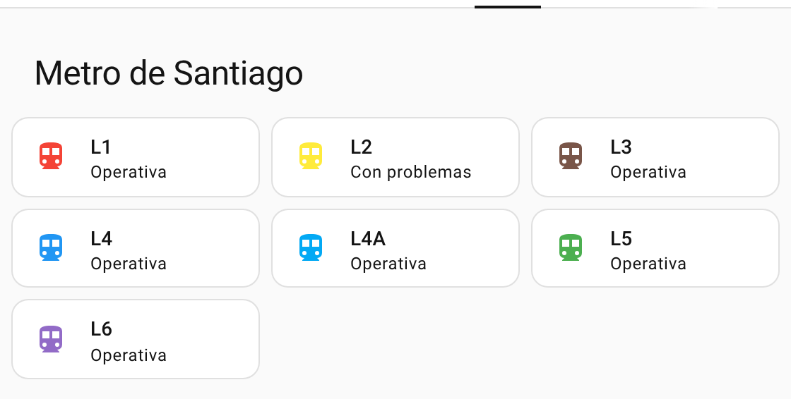

*Ejemplo con un incidente simulado en la Línea 2.*

```yaml
type: grid
title: Metro de Santiago
columns: 3
square: false
cards:
  - type: tile
    entity: sensor.metro_de_santiago_linea_1
    name: L1
    color: red
  - type: tile
    entity: sensor.metro_de_santiago_linea_2
    name: L2
    color: yellow
  - type: tile
    entity: sensor.metro_de_santiago_linea_3
    name: L3
    color: brown
  - type: tile
    entity: sensor.metro_de_santiago_linea_4
    name: L4
    color: blue
  - type: tile
    entity: sensor.metro_de_santiago_linea_4a
    name: L4A
    color: light-blue
  - type: tile
    entity: sensor.metro_de_santiago_linea_5
    name: L5
    color: green
  - type: tile
    entity: sensor.metro_de_santiago_linea_6
    name: L6
    color: purple
```

Resumen con las estaciones afectadas (o el aviso de que el Metro está cerrado):

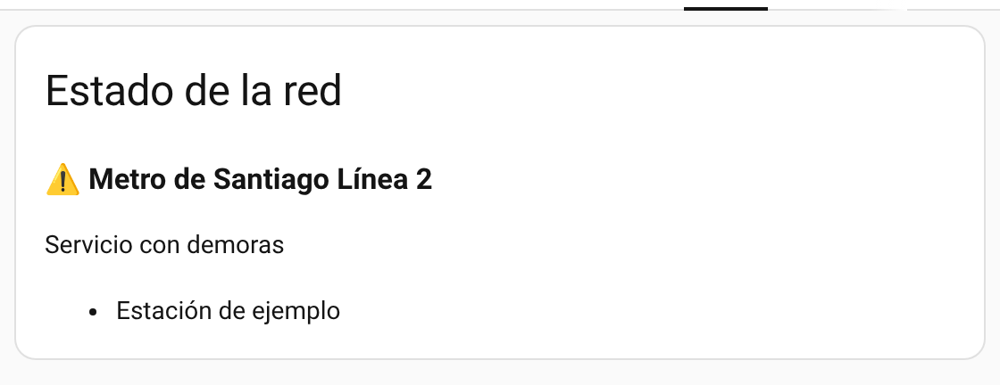

*Ejemplo con un incidente simulado en la Línea 2.*

```yaml
type: markdown
title: Estado de la red
content: |
  
  
  
  
  🌙 **Metro cerrado.** Abre a las {{ lineas[0].attributes.horario_apertura }}.
  
  
  ### ⚠️ {{ l.name }}
  {{ l.attributes.mensaje }}
  - {{ e }}
  
  
  
  ✅ Sin incidentes en la red.
  
  Sin datos del Metro.
  
```

## 🚌 Paraderos

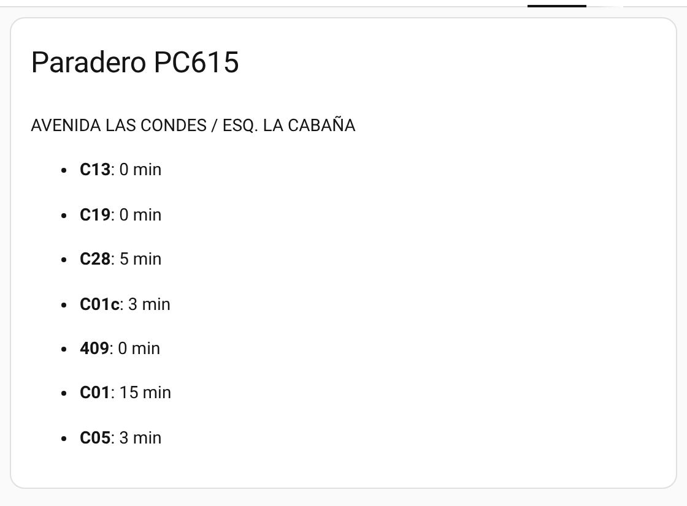

```yaml
type: markdown
title: Paradero PC615
content: |
  
  {{ state_attr('sensor.paraderos_red_movilidad_paradero_pc615', 'nombre') or '' }}

  
  
  - **{{ recorrido }}**: {{ info.minutos }} min
  
  
  No hay buses en camino.
  
```

Varios paraderos de un vistazo:

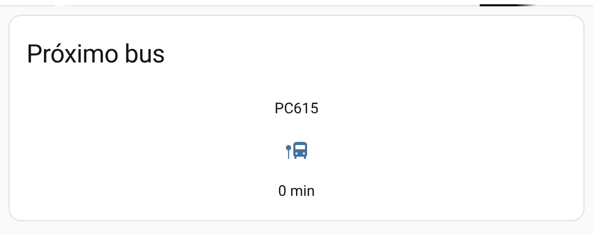

```yaml
type: glance
title: Próximo bus
entities:
  - entity: sensor.paraderos_red_movilidad_paradero_pc615
    name: PC615
```

## 🚍 Paraderos de la Red Regional
Próximas llegadas a un paradero fuera de Santiago (cambia la ciudad y el código por los tuyos).

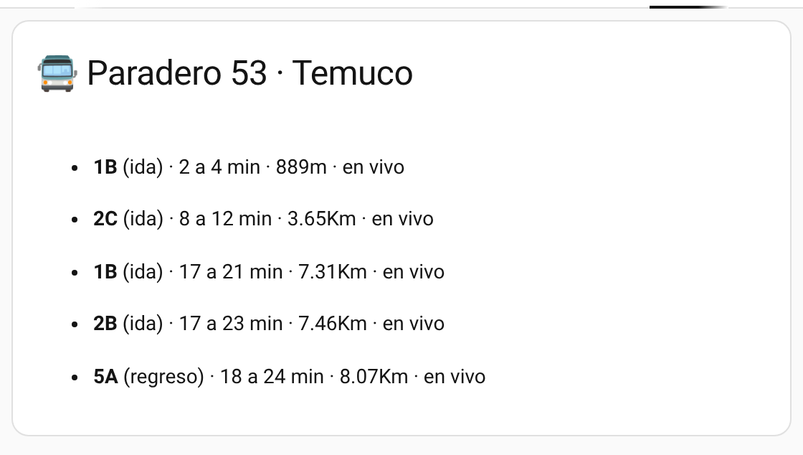

```yaml
type: markdown
title: 🚍 Paradero 53 · Temuco
content: |
  
  
  Sin buses próximos.
  
  
  - **{{ b.servicio }}** ({{ b.sentido }}) · {{ b.estimacion }} · {{ b.distancia }}{{ ' · en vivo' if b.tiempo_real }}
  
  
  
  ⚠️ {{ a }}
  
```

## 🚆 Tren Limache–Puerto
Los próximos trenes de un trayecto, con la hora estimada y los que no llegan a tu destino marcados (cambia el sensor por el tuyo):

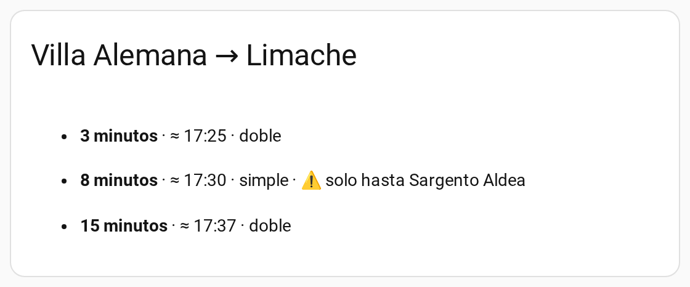

```yaml
type: markdown
title: Villa Alemana → Limache
content: |
  
  
  - **{{ t.tiempo }}** · ≈ {{ as_timestamp(t.hora_estimada) | timestamp_custom('%H:%M') }} · {{ t.tipo }} · ⚠️ solo hasta {{ t.estacion_final }}
  
  {{ 'Sin datos de EFE por ahora.' if states(e) in ['unavailable', 'unknown'] else 'Sin servicios informados.' }}
  
```

Ida y vuelta de un vistazo:

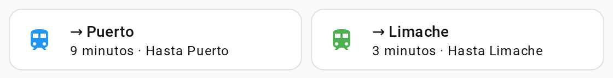

```yaml
type: grid
columns: 2
square: false
cards:
  - type: tile
    entity: sensor.tren_limache_puerto_villa_alemana_puerto
    name: → Puerto
    icon: mdi:train
    color: blue
    state_content: [state, hasta]
  - type: tile
    entity: sensor.tren_limache_puerto_villa_alemana_limache
    name: → Limache
    icon: mdi:train
    color: green
    state_content: [state, hasta]
```

## 🌋 Sismos

Mapa del último sismo (USGS trae las coordenadas):

```yaml
type: map
title: Último sismo
entities:
  - entity: sensor.sismos_chile_ultimo_sismo_con_coordenadas_usgs
    label_mode: state
default_zoom: 6
```

Último sismo del Centro Sismológico Nacional, en palabras:

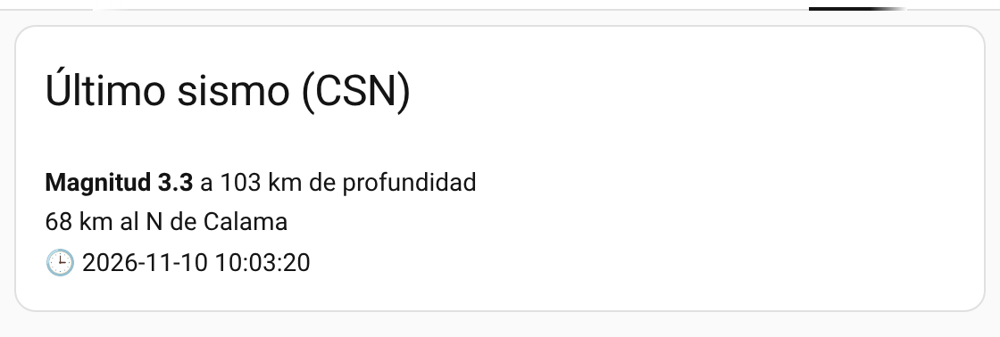

```yaml
type: markdown
title: Último sismo (CSN)
content: |
  **Magnitud {{ states('sensor.sismos_chile_ultimo_sismo_csn') }}** a {{ state_attr('sensor.sismos_chile_ultimo_sismo_csn', 'profundidad_km') | int(0) }} km de profundidad  
  {{ state_attr('sensor.sismos_chile_ultimo_sismo_csn', 'referencia') }}  
  🕒 {{ state_attr('sensor.sismos_chile_ultimo_sismo_csn', 'fecha') }}
```

## 📅 Feriados

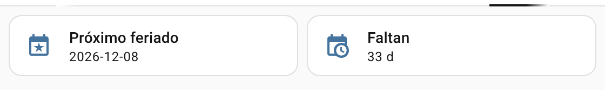

```yaml
type: grid
columns: 2
square: false
cards:
  - type: tile
    entity: sensor.feriados_chile_proximo_feriado
    name: Próximo feriado
    icon: mdi:calendar-star
  - type: tile
    entity: sensor.feriados_chile_dias_para_el_proximo_feriado
    name: Faltan
    icon: mdi:calendar-clock
```

Con el nombre del feriado:

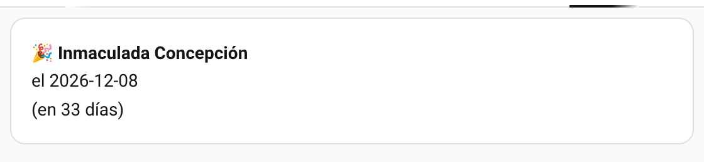

```yaml
type: markdown
content: |
  🎉 **{{ state_attr('sensor.feriados_chile_proximo_feriado', 'nombre') }}**
  el {{ states('sensor.feriados_chile_proximo_feriado') }}
  (en {{ states('sensor.feriados_chile_dias_para_el_proximo_feriado') }} días)
  · irrenunciable
```

## 🌫️ Calidad del aire y UV

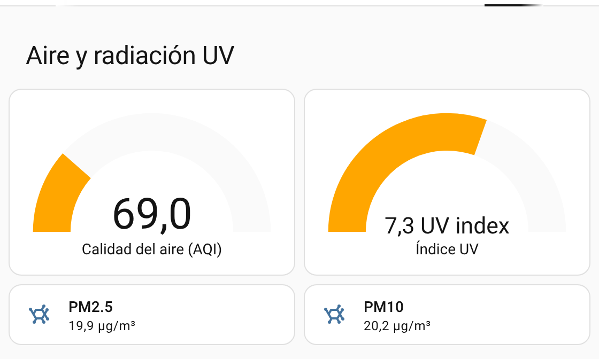

```yaml
type: grid
title: Aire y radiación UV
columns: 2
square: false
cards:
  - type: gauge
    entity: sensor.calidad_del_aire_y_uv_indice_de_calidad_del_aire_us_aqi
    name: Calidad del aire (AQI)
    min: 0
    max: 300
    severity:
      green: 0
      yellow: 51
      red: 101
  - type: gauge
    entity: sensor.calidad_del_aire_y_uv_indice_uv
    name: Índice UV
    min: 0
    max: 12
    severity:
      green: 0
      yellow: 3
      red: 8
  - type: tile
    entity: sensor.calidad_del_aire_y_uv_pm2_5
    name: PM2.5
  - type: tile
    entity: sensor.calidad_del_aire_y_uv_pm10
    name: PM10
```

## 💊 Farmacias de turno

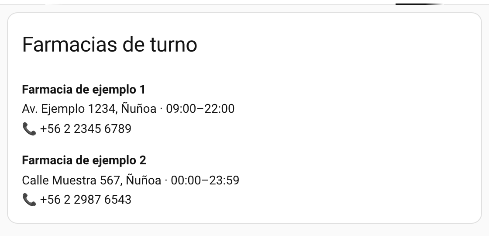

*Datos de ejemplo.*

```yaml
type: markdown
title: Farmacias de turno
content: |
  
  
  
  **{{ x.nombre }}**  
  {{ x.direccion }} · {{ x.apertura }}–{{ x.cierre }}  
  📞 {{ x.telefono }}

  
  
  Sin farmacias de turno registradas hoy.
  
```

## 🎬 Cine

Cartelera de hoy con el póster de cada película (el ejemplo muestra las 6 primeras; quita `[:6]` para verlas todas):

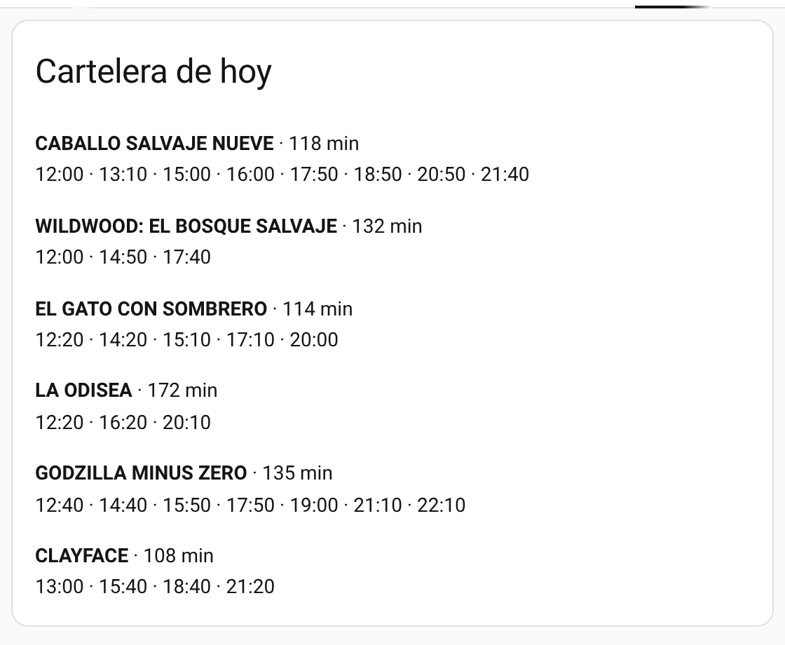

```yaml
type: markdown
title: Cartelera de hoy
content: |
  <table>
  
  <tr>
  <td></td>
  <td><b>{{ m.titulo }}</b> · {{ m.duracion_min }} min<br>{{ m.funciones | map(attribute='hora') | join(' · ') }}</td>
  </tr>
  
  </table>
```

Próxima función con su póster:

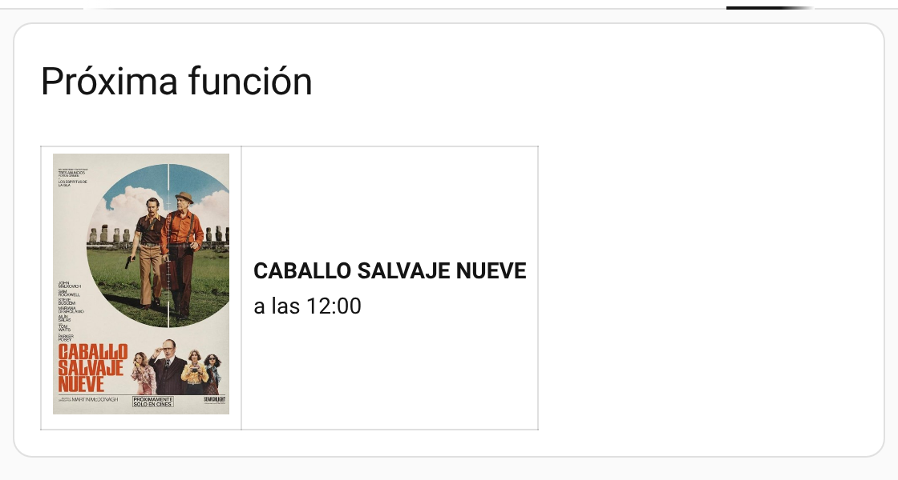

```yaml
type: markdown
title: Próxima función
content: |
  
  
  <table>
  <tr>
  <td></td>
  <td><b>{{ n.titulo }}</b><br>a las {{ n.hora }}</td>
  </tr>
  </table>
  
  Hoy no quedan más funciones.
  
```

El sensor también entrega el póster de la próxima función como imagen de la entidad, así que las tarjetas que muestran la
imagen de una entidad (como `tile`) lo usan directamente:

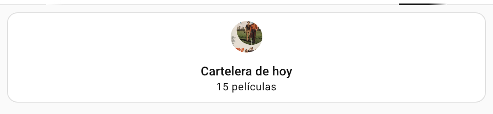

```yaml
type: tile
entity: sensor.cinemark_alto_las_condes_cartelera_de_hoy
name: Cartelera de hoy
show_entity_picture: true
vertical: true
```

Versión corta (texto ya armado por la integración) y próxima función:

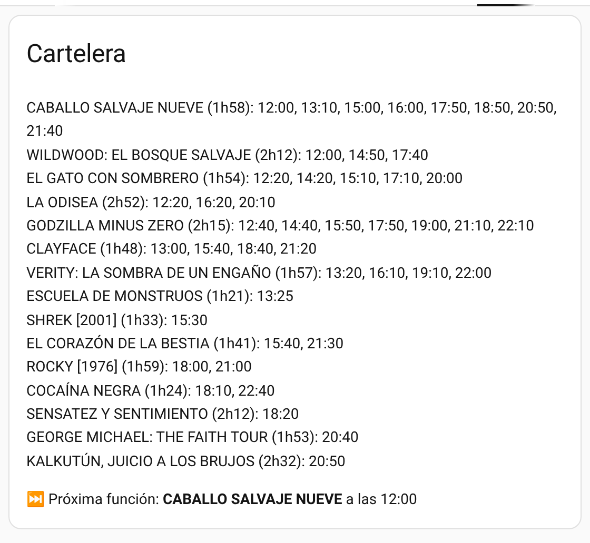

```yaml
type: markdown
title: Cartelera
content: |
  {{ state_attr('sensor.cinemark_alto_las_condes_cartelera_de_hoy', 'resumen') }}

  
  ⏭️ Próxima función: **{{ n.titulo }}** a las {{ n.hora }}
```

## 🇨🇱 Efemérides

Las de hoy, con su fuente:

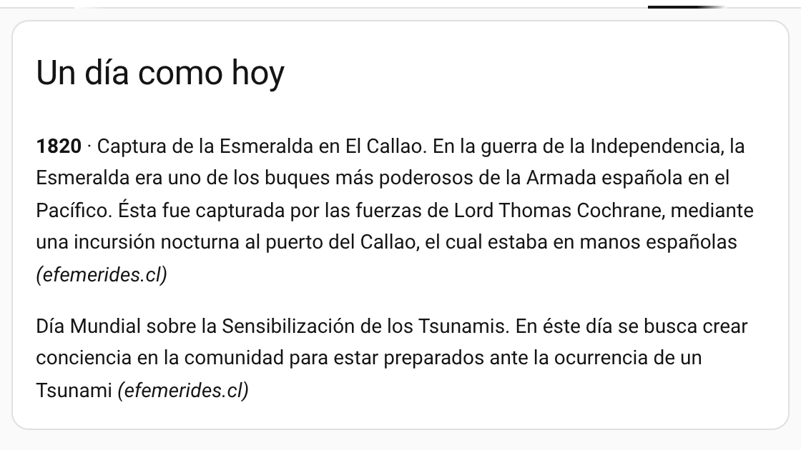

```yaml
type: markdown
title: Un día como hoy
content: |
  
  **{{ e.anio }}** · {{ e.texto }} _({{ e.fuente }})_

  
  Sin efemérides chilenas registradas para hoy.
  
```

Próximo día significativo:

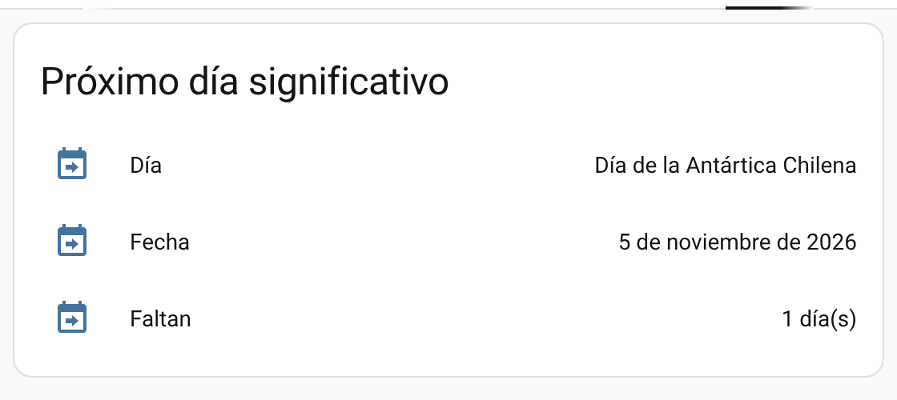

```yaml
type: entities
title: Próximo día significativo
entities:
  - entity: sensor.efemerides_chilenas_proximo_dia_significativo
    name: Día
  - type: attribute
    entity: sensor.efemerides_chilenas_proximo_dia_significativo
    attribute: fecha
    name: Fecha
  - type: attribute
    entity: sensor.efemerides_chilenas_proximo_dia_significativo
    attribute: dias_restantes
    name: Faltan
    suffix: día(s)
```

## ✝️ Santoral

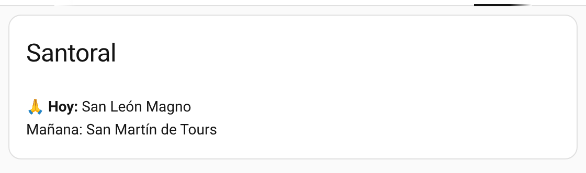

```yaml
type: markdown
title: Santoral
content: |
  🙏 **Hoy:** {{ states('sensor.santoral_santo_del_dia') }}  
  Mañana: {{ state_attr('sensor.santoral_santo_del_dia', 'mañana') }}
```

## ⚽ Fútbol

Tu equipo: próximo partido, último resultado y posición en la tabla (cambia `colo_colo` por tu equipo):

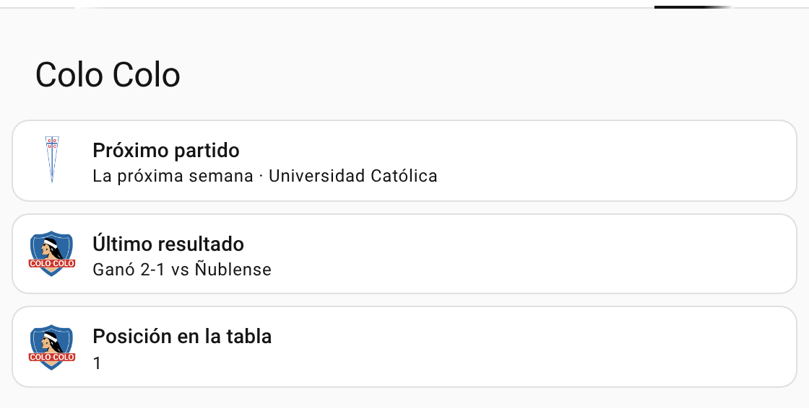

```yaml
type: grid
title: Colo Colo
columns: 1
square: false
cards:
  - type: tile
    entity: sensor.futbol_colo_colo_proximo_partido
    name: Próximo partido
    show_entity_picture: true
    state_content:
      - state
      - rival
  - type: tile
    entity: sensor.futbol_colo_colo_ultimo_resultado
    name: Último resultado
    show_entity_picture: true
  - type: tile
    entity: sensor.futbol_colo_colo_posicion_en_la_tabla
    name: Posición en la tabla
    show_entity_picture: true
```

Más detalle del próximo partido y de la campaña:

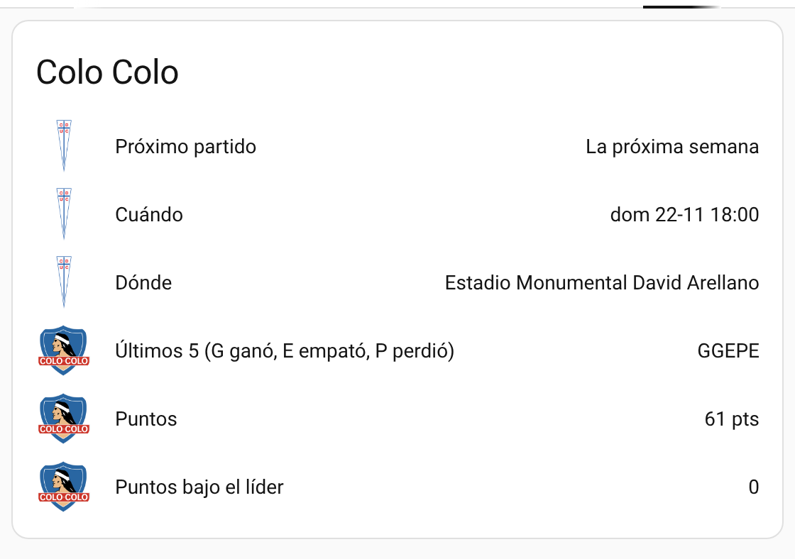

```yaml
type: entities
title: Colo Colo
entities:
  - entity: sensor.futbol_colo_colo_proximo_partido
    name: Próximo partido
  - type: attribute
    entity: sensor.futbol_colo_colo_proximo_partido
    attribute: hora_local
    name: Cuándo
  - type: attribute
    entity: sensor.futbol_colo_colo_proximo_partido
    attribute: estadio
    name: Dónde
  - type: attribute
    entity: sensor.futbol_colo_colo_ultimo_resultado
    attribute: forma
    name: Últimos 5 (G ganó, E empató, P perdió)
  - type: attribute
    entity: sensor.futbol_colo_colo_posicion_en_la_tabla
    attribute: puntos
    name: Puntos
    suffix: pts
  - type: attribute
    entity: sensor.futbol_colo_colo_posicion_en_la_tabla
    attribute: puntos_bajo_el_lider
    name: Puntos bajo el líder
```

Los partidos de la próxima fecha de la Primera División:

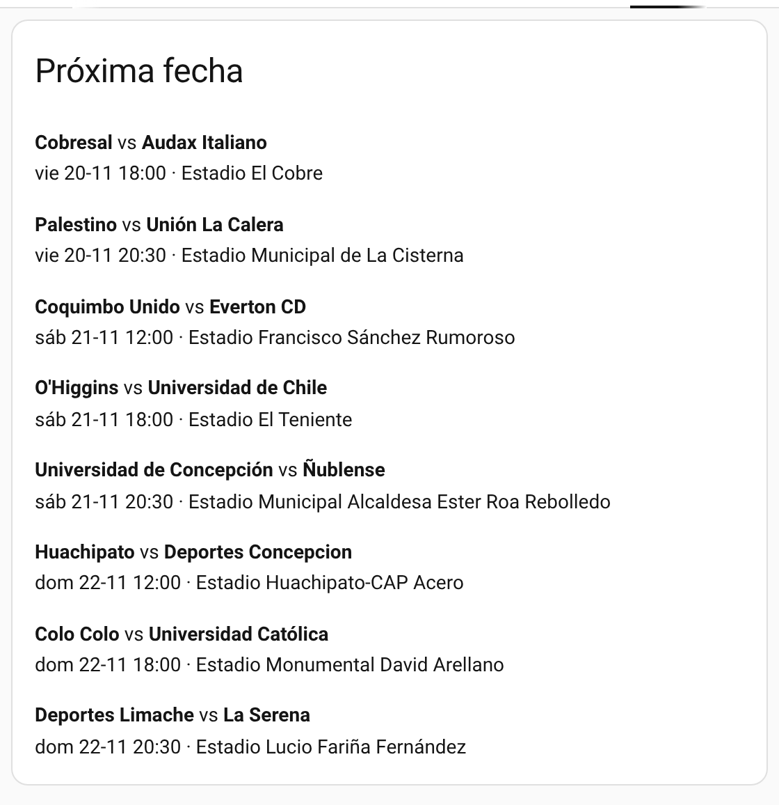

```yaml
type: markdown
title: Próxima fecha
content: |
  
  **{{ p.local }}** vs **{{ p.visita }}**  
  {{ p.hora_local }} · {{ p.estadio }}

  
  No hay partidos programados.
  
```

Resultados de la última fecha:

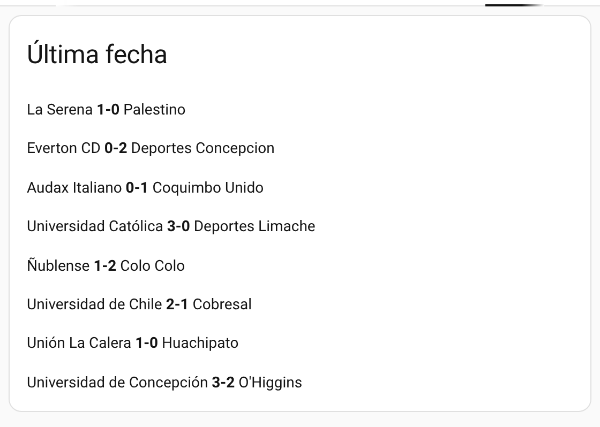

```yaml
type: markdown
title: Última fecha
content: |
  
  {{ r.local }} **{{ r.marcador }}** {{ r.visita }}  
  
```

Tabla de posiciones (los 8 primeros):

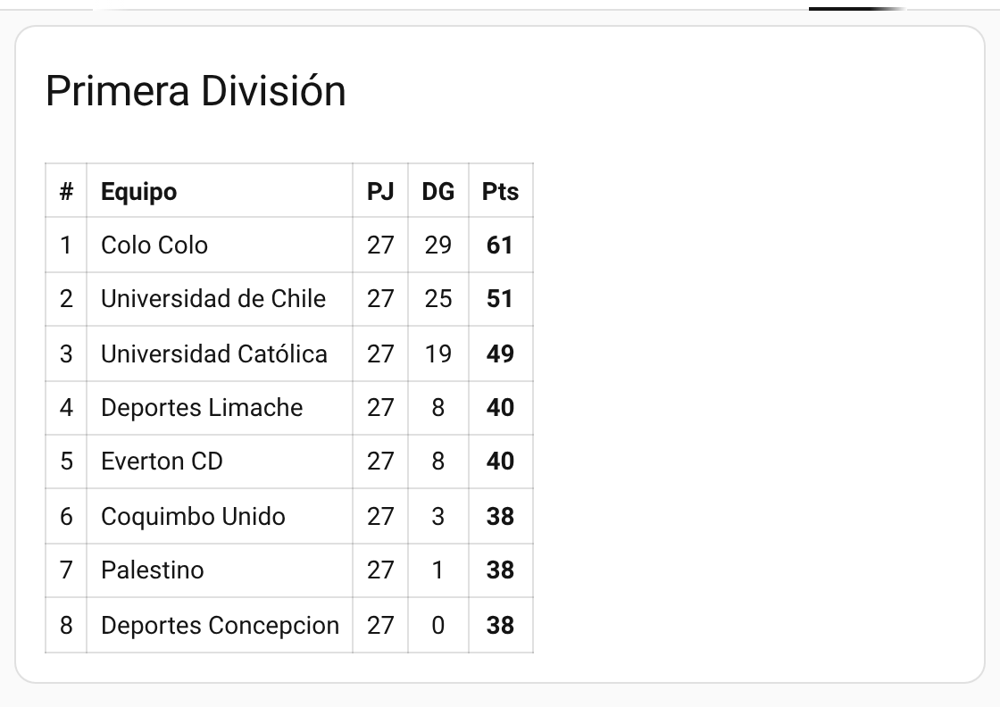

```yaml
type: markdown
title: Primera División
content: |
  | # | Equipo | PJ | DG | Pts |
  |:-:|:--|:-:|:-:|:-:|
  
  | {{ f.posicion }} | {{ f.equipo }} | {{ f.pj }} | {{ f.dg }} | **{{ f.pts }}** |
  
```

La Roja:

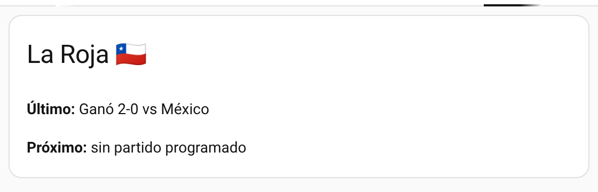

```yaml
type: markdown
title: La Roja 🇨🇱
content: |
  
  **Último:** {{ states('sensor.futbol_la_roja_ultimo_resultado') }}  
  
  **Próximo:** vs {{ state_attr(n, 'rival') }} — {{ state_attr(n, 'hora_local') }} ({{ state_attr(n, 'competencia') }})
  
  **Próximo:** sin partido programado
  
```

## ⛽ Combustibles

La bencina y el diésel más baratos cerca de tu casa, con la marca de la estación:

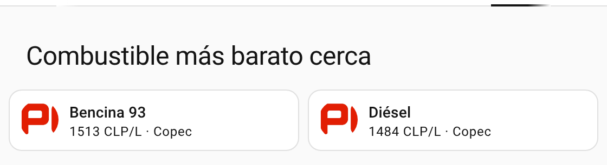

```yaml
type: grid
title: Combustible más barato cerca
columns: 2
square: false
cards:
  - type: tile
    entity: sensor.combustibles_gasolina_93_mas_barata
    name: Bencina 93
    show_entity_picture: true
    state_content:
      - state
      - marca
  - type: tile
    entity: sensor.combustibles_diesel_mas_barato
    name: Diésel
    show_entity_picture: true
    state_content:
      - state
      - marca
```

Las 5 estaciones más baratas de bencina 93:

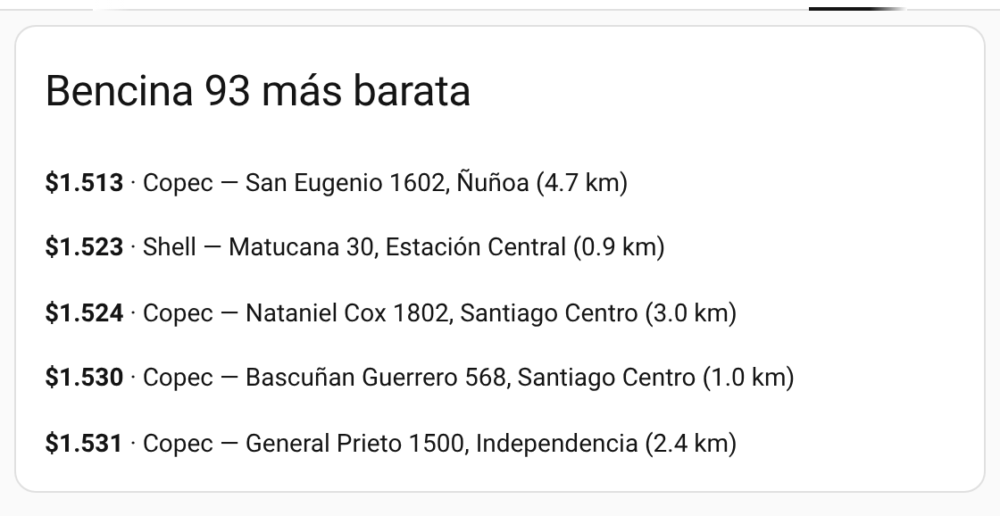

```yaml
type: markdown
title: Bencina 93 más barata
content: |
  
  **${{ '{:,.0f}'.format(e.precio) | replace(',', '.') }}** · {{ e.marca }} — {{ e.direccion }}, {{ e.comuna }} ({{ e.distancia_km }} km)  
  
  No hay estaciones con precio vigente cerca.
  
```

Precio, promedio de la zona y cuántas estaciones hay:

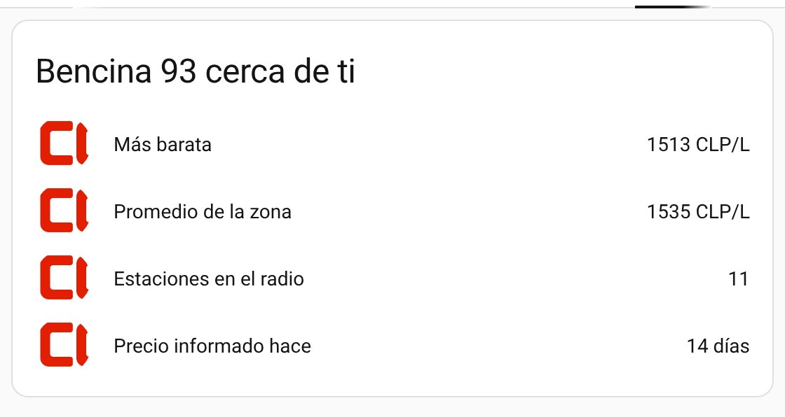

```yaml
type: entities
title: Bencina 93 cerca de ti
entities:
  - entity: sensor.combustibles_gasolina_93_mas_barata
    name: Más barata
  - type: attribute
    entity: sensor.combustibles_gasolina_93_mas_barata
    attribute: promedio_en_radio
    name: Promedio de la zona
    suffix: CLP/L
  - type: attribute
    entity: sensor.combustibles_gasolina_93_mas_barata
    attribute: estaciones_en_radio
    name: Estaciones en el radio
  - type: attribute
    entity: sensor.combustibles_gasolina_93_mas_barata
    attribute: antiguedad_dias
    name: Precio informado hace
    suffix: días
```

## 💳 Descuentos de tus tarjetas
Lista de los descuentos de hoy en una categoría (cambia `comida` por `combustibles`, `salud_y_belleza`, etc.).

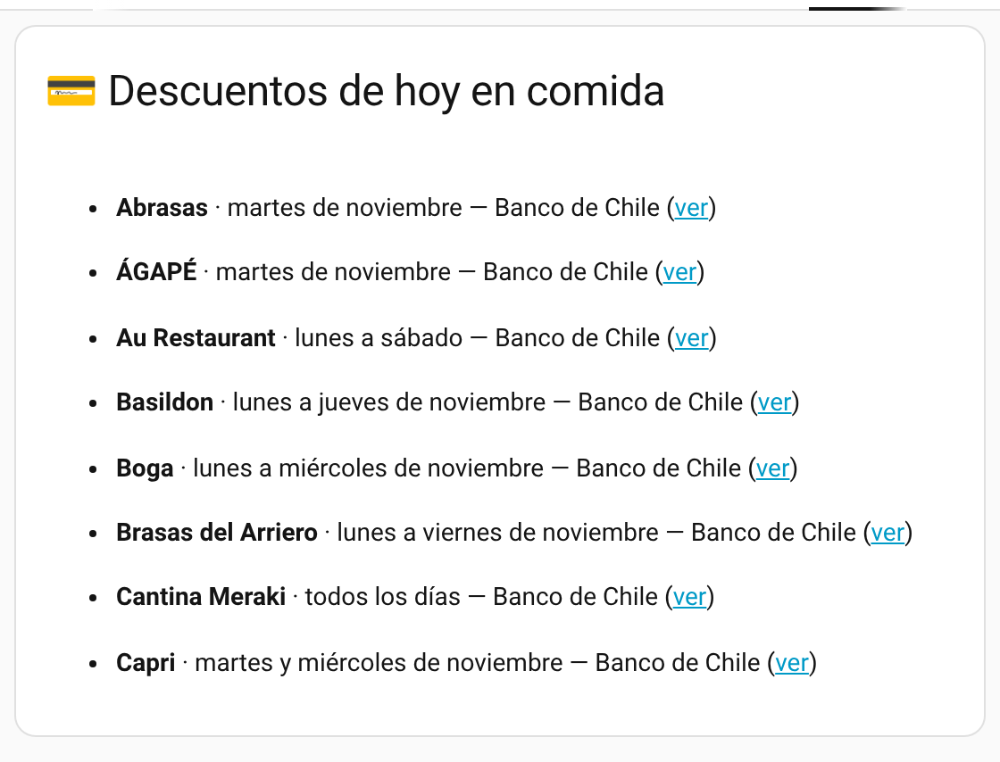

```yaml
type: markdown
title: 💳 Descuentos de hoy en comida
content: |
  
  
  Hoy no hay descuentos de tus tarjetas en esta categoría.
  
  
  - **{{ b.comercio }}** · {{ b.descuento }} — {{ b.tarjeta }} ([ver]({{ b.url }}))
  
  
```

Aviso en el celular cuando hay descuentos (automatización):

```yaml
alias: Descuentos de hoy en combustibles
triggers:
  - trigger: state
    entity_id: sensor.descuentos_de_tarjetas_descuentos_de_hoy_combustibles
conditions:
  - condition: numeric_state
    entity_id: sensor.descuentos_de_tarjetas_descuentos_de_hoy_combustibles
    above: 0
actions:
  - action: notify.notify          # cambia por tu servicio, p. ej. notify.mobile_app_mi_celular
    data:
      title: 💳 Descuentos de hoy
      message: |
        
        {{ b.comercio }}: {{ b.descuento }} ({{ b.tarjeta }})
        
```

## 📰 Noticias por tema
Titulares de un tema con enlace a la nota (cambia `nacional` por `politica`, `mundo`, `economia`, `deportes`…).

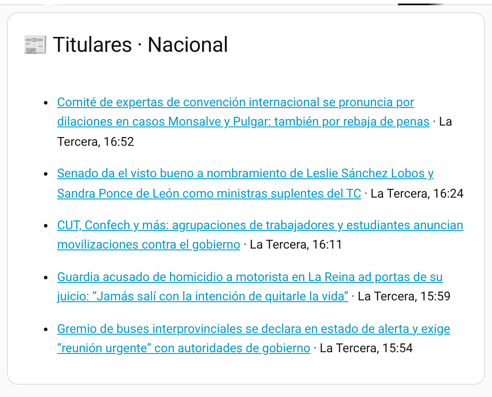

```yaml
type: markdown
title: 📰 Titulares · Nacional
content: |
  
  - [{{ n.titulo }}]({{ n.enlace }}) · {{ n.medio }}, {{ n.hora[-5:] }}
  
```

## 🎭 Panoramas

Los eventos culturales de hoy en tu comuna, con el recinto, si son gratis y el enlace (cambia `santiago` por tu comuna en los ids):

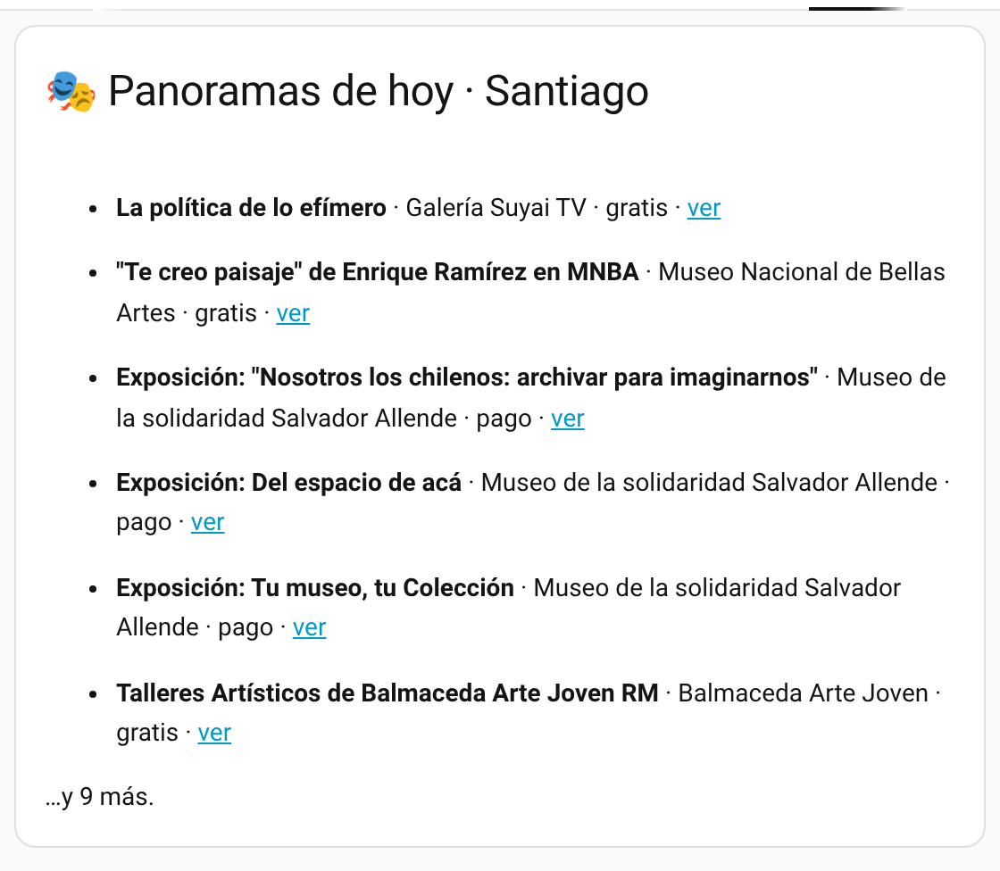

```yaml
type: markdown
title: 🎭 Panoramas de hoy · Santiago
content: |
  
  
  - **{{ e.nombre }}** · {{ e.recinto }} · {{ 'gratis' if e.gratis else 'pago' }} · [ver]({{ e.enlace }})
  
  Hoy no hay eventos publicados en tu comuna.
  
  …y {{ hoy | length - 6 }} más.
```

Lo que viene en el Claro Arena, con enlace para comprar entradas:

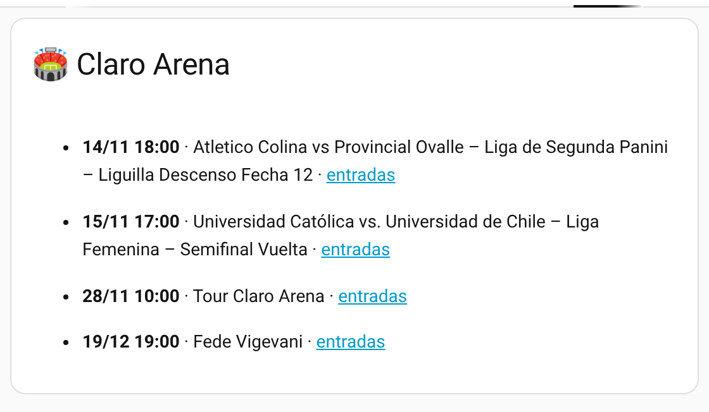

```yaml
type: markdown
title: 🏟️ Claro Arena
content: |
  
  
  - **{{ x.fecha[8:10] }}/{{ x.fecha[5:7] }} {{ x.hora }}** · {{ x.titulo }} · [entradas]({{ x.entradas }})
  
  Sin eventos con fecha por ahora.
  
```

### Panoramas por Vamoh

Los planes destacados de Vamoh, con enlace a la ficha de cada uno en Vamoh. Requiere el enlace del calendario de Vamoh en las opciones de Navaja Chilena.

```yaml
type: markdown
title: ✨ Panoramas por Vamoh
content: |
  
  
  - **{{ e.fecha[8:10] }}/{{ e.fecha[5:7] }} {{ e.hora }}** · {{ e.titulo }} · {{ e.lugar }} · [ver en Vamoh]({{ e.ficha }})
  
  Vamoh no tiene panoramas destacados por ahora.
  

  <sub>Panoramas por <a href="https://vamoh.cl">Vamoh</a></sub>
```

## 📍 Cerca de ti

Requiere activar **«Cerca de ti»** en las opciones (elige tu teléfono y la distancia). Las tarjetas muestran algo solo cuando estás cerca.

Próxima función cuando pasas cerca de un Cinemark:

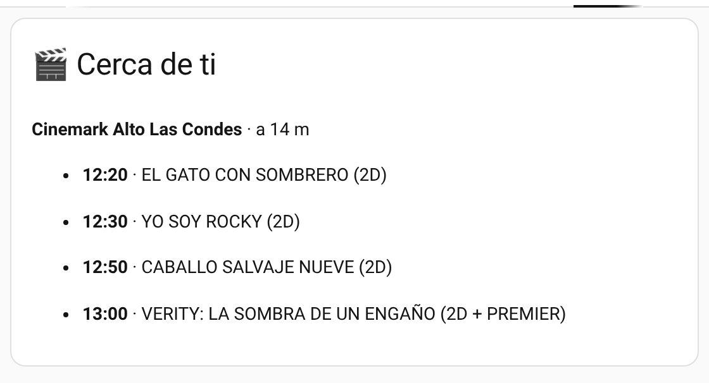

```yaml
type: markdown
title: 🎬 Cerca de ti
content: |
  
  
  **{{ state_attr(e, 'cine_mas_cercano') }}** · a {{ state_attr(e, 'distancia_m') }} m
  
  - **{{ f.hora }}** · {{ f.titulo }} ({{ f.formato }})
  
  
  Estás cerca de **{{ state_attr(e, 'cine_mas_cercano') }}**, pero no hay funciones para mostrar ahora.
  
  Cuando pases cerca de un Cinemark, aquí verás la próxima función.
  
```

Estación con descuento hoy para tus tarjetas:

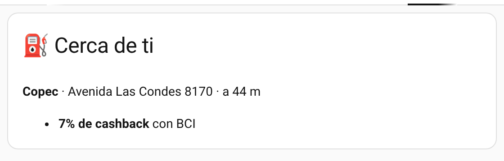

```yaml
type: markdown
title: ⛽ Cerca de ti
content: |
  
  
  **{{ state_attr(e, 'estacion_mas_cercana') }}** · {{ state_attr(e, 'direccion') }} · a {{ state_attr(e, 'distancia_m') }} m
  
  - **{{ d.descuento }}** con {{ d.tarjeta }} (por confirmar)
  
  
  Hoy hay descuento en: {{ state_attr(e, 'marcas_con_descuento_hoy') | join(', ') or 'ninguna marca' }}. Te avisaré al pasar cerca.
  
```

**Automatización: aviso al pasar cerca de un Cinemark** (como máximo una vez cada 3 horas y solo por la tarde):

```yaml
alias: Aviso al pasar cerca de un Cinemark
triggers:
  - trigger: state
    entity_id: binary_sensor.cerca_de_ti_cerca_de_un_cinemark
    to: "on"
conditions:
  - condition: time
    after: "12:00:00"
    before: "22:30:00"
  - condition: template
    value_template: "{{ state_attr(trigger.entity_id, 'proxima_funcion') is not none }}"
  - condition: template
    value_template: >-
      {{ this.attributes.last_triggered is none
         or (now() - this.attributes.last_triggered).total_seconds() > 10800 }}
actions:
  - action: notify.notify          # cambia por tu servicio, p. ej. notify.mobile_app_mi_celular
    data:
      title: "🎬 {{ state_attr(trigger.entity_id, 'cine_mas_cercano') }}"
      message: >-
        
        Próxima función a las {{ f.hora }}: {{ f.titulo }}.
```

**Automatización: aviso al pasar cerca de una estación con descuento hoy:**

```yaml
alias: Descuento de bencina cerca
triggers:
  - trigger: state
    entity_id: binary_sensor.cerca_de_ti_cerca_de_una_estacion_con_descuento
    to: "on"
conditions:
  - condition: template
    value_template: >-
      {{ this.attributes.last_triggered is none
         or (now() - this.attributes.last_triggered).total_seconds() > 10800 }}
actions:
  - action: notify.notify
    data:
      title: "⛽ {{ state_attr(trigger.entity_id, 'estacion_mas_cercana') }} a {{ state_attr(trigger.entity_id, 'distancia_m') }} m"
      message: >-
        {{ d.descuento }} con {{ d.tarjeta }}{{ ' · ' if not loop.last }}
```

**Automatización «con zona»** para un restaurante o tienda: crea una zona en *Ajustes → Áreas, etiquetas y zonas → Zonas* en ese local (radio de 50 a 100 m) y avisa al entrar si hoy tienes un descuento ahí
(cambia `Abrasas`, la zona, tu persona y la categoría del sensor):

```yaml
alias: Descuento de hoy en mi restaurante favorito
triggers:
  - trigger: zone
    entity_id: person.tu_persona
    zone: zone.restaurante_abrasas
    event: enter
conditions:
  - condition: template
    value_template: >-
      {{ (state_attr('sensor.descuentos_de_tarjetas_descuentos_de_hoy_comida', 'hoy') or [])
         | selectattr('comercio', 'search', 'Abrasas') | list | count > 0 }}
actions:
  - action: notify.notify
    data:
      title: "🍽️ Hoy tienes descuento aquí"
      message: >-
        
        {{ d.comercio }}: {{ d.descuento }} con {{ d.tarjeta }}.
```

## 🚗 Mi vehículo

Restricción de hoy, dígitos restringidos, próxima fecha y mes de revisión técnica:

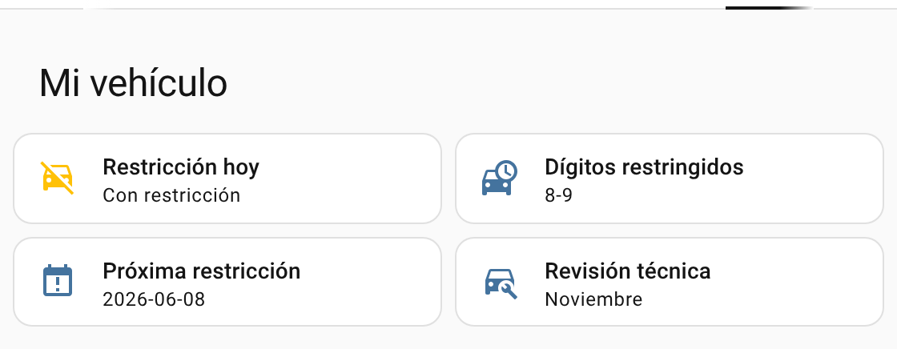

*Ejemplo con fecha simulada: lunes 8 de junio de 2026, dentro de la temporada de restricción (hoy no hay restricción).*

```yaml
type: grid
title: Mi vehículo
columns: 2
square: false
cards:
  - type: tile
    entity: binary_sensor.mi_vehiculo_restriccion_vehicular_hoy
    name: Restricción hoy
  - type: tile
    entity: sensor.mi_vehiculo_digitos_con_restriccion_hoy
    name: Dígitos restringidos
  - type: tile
    entity: sensor.mi_vehiculo_proxima_restriccion
    name: Próxima restricción
  - type: tile
    entity: sensor.mi_vehiculo_mes_de_revision_tecnica
    name: Revisión técnica
```

Aviso en palabras:

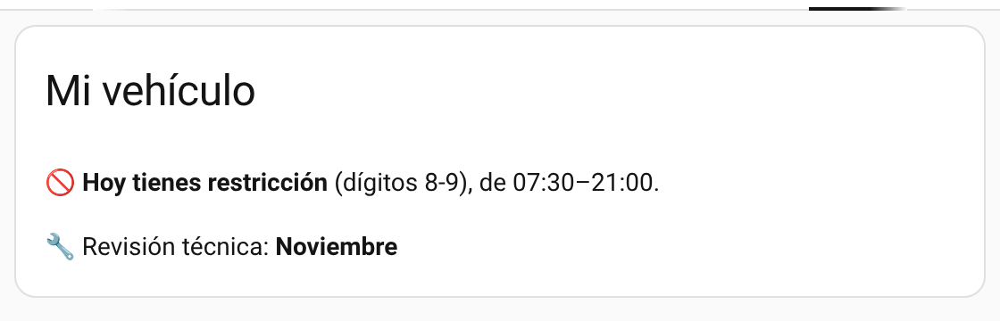

*Ejemplo con fecha simulada: lunes 8 de junio de 2026, dentro de la temporada de restricción (hoy no hay restricción).*

```yaml
type: markdown
title: Mi vehículo
content: |
  
  
  🚫 **Hoy tienes restricción** (dígitos {{ state_attr(r, 'digitos_hoy') }}), de {{ state_attr(r, 'horario') }}.
  
  ✅ **Hoy no tienes restricción.** {{ state_attr(r, 'motivo') }}.
  
  Sin datos de restricción para hoy.
  

  🔧 Revisión técnica: **{{ states('sensor.mi_vehiculo_mes_de_revision_tecnica') }}** (¡te toca este mes!)
```

### 🚗 Varios vehículos

Si registraste más de un vehículo (el principal y los de *Otros vehículos*), este resumen los junta en una sola tarjeta. Ajusta la lista de nombres y de dispositivos a los tuyos:

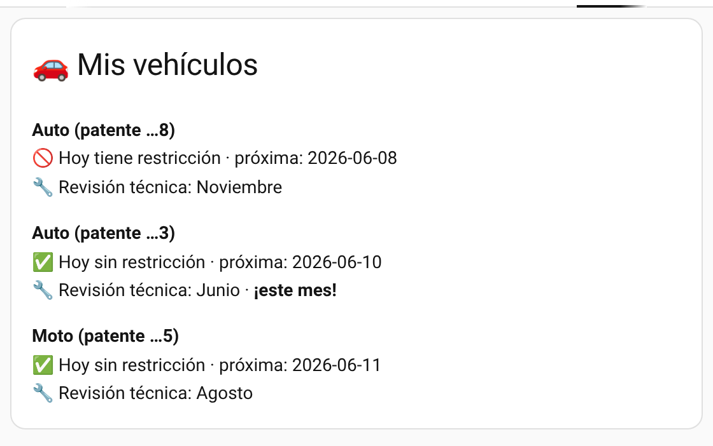

*Ejemplo con fecha simulada: lunes 8 de junio de 2026, dentro de la temporada de restricción.*

```yaml
type: markdown
title: 🚗 Mis vehículos
content: |
  
  
  **{{ nombre }}**  
  🚫 Hoy tiene restricción✅ Hoy sin restricción · próxima: {{ states('sensor.' ~ id ~ '_proxima_restriccion') }}  
  🔧 Revisión técnica: {{ states('sensor.' ~ id ~ '_mes_de_revision_tecnica') }} · **¡este mes!**
  
```

## ☀️ Resumen del día (todo junto)

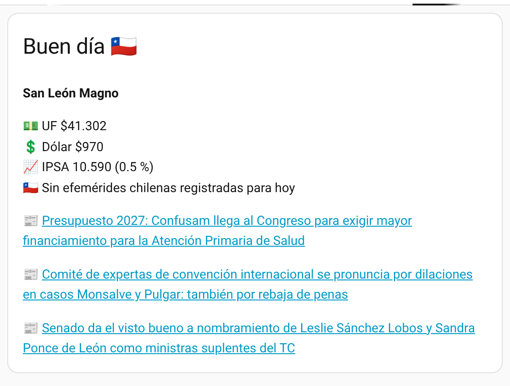

```yaml
type: markdown
title: Buen día 🇨🇱
content: |
  **{{ states('sensor.santoral_santo_del_dia') }}**

  💵 UF ${{ '{:,.0f}'.format(states('sensor.indicadores_economicos_uf') | float(0)) | replace(',', '.') }}  
  💲 Dólar ${{ '{:,.0f}'.format(states('sensor.indicadores_economicos_dolar_observado') | float(0)) | replace(',', '.') }}  
  📈 IPSA {{ '{:,.0f}'.format(states('sensor.bolsa_de_santiago_ipsa') | float(0)) | replace(',', '.') }} ({{ state_attr('sensor.bolsa_de_santiago_ipsa', 'variacion_pct') }} %)  
  🇨🇱 {{ states('sensor.efemerides_chilenas_efemerides_de_hoy') }}

  
  📰 [{{ n.titulo }}]({{ n.enlace }})  
  
```

## 🌅 Resumen de la mañana en tu celular
Una notificación diaria que junta lo que ya tienes en Navaja Chilena: el santo, UF y dólar, si hoy tienes restricción vehicular, los descuentos en bencina de tus
tarjetas, el próximo feriado y tres titulares. Solo aparece lo que corresponde: si hoy no tienes restricción ni descuentos, esas líneas no salen.

```yaml
alias: Resumen de la mañana
triggers:
  - trigger: time
    at: "07:30:00"
actions:
  - action: notify.notify          # cambia por tu servicio, p. ej. notify.mobile_app_mi_celular
    data:
      title: "🇨🇱 Buen día{{ ' · ' ~ states('sensor.santoral_santo_del_dia') if has_value('sensor.santoral_santo_del_dia') }}"
      message: |
        
        💵 UF ${{ '{:,.0f}'.format(states('sensor.indicadores_economicos_uf') | float(0)) | replace(',', '.') }} · Dólar ${{ '{:,.0f}'.format(states('sensor.indicadores_economicos_dolar_observado') | float(0)) | replace(',', '.') }}
        
        
        🚗 Hoy tienes restricción vehicular ({{ state_attr('binary_sensor.mi_vehiculo_restriccion_vehicular_hoy', 'horario') }})
        
        
        ⛽ Bencina con descuento hoy: {{ d.tarjeta }} en {{ d.estaciones | join('/') }} ({{ d.descuento }}){{ ', ' if not loop.last }}
        
        
        🎉 Hoy es feriado: {{ state_attr('sensor.feriados_chile_proximo_feriado', 'nombre') }}
        
        📅 Próximo feriado: {{ state_attr('sensor.feriados_chile_proximo_feriado', 'nombre') }} (en {{ states('sensor.feriados_chile_dias_para_el_proximo_feriado') }} días)
        
        
        📰 {{ n.titulo }}
        
```

Cada línea aparece solo si ese módulo está activado: el resumen se arma con lo que tú elegiste. Los nombres de las entidades son los de tu instalación; si
cambiaste alguno, ajústalo en la plantilla.

[← Volver al README](../README.md)
